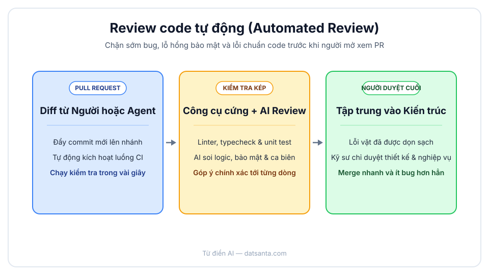

# Automated Code Review (Review code tự động)

**Automated code review** kết hợp AI agent cùng các công cụ tất định như linter, typechecker và unit test để kiểm tra mọi pull request tìm bug, lỗ hổng bảo mật hay lệch chuẩn trước khi kỹ sư mở xem diff.

## Ví dụ thực tế

Trước khi phi công bước vào buồng lái, đội kỹ thuật mặt đất luôn chạy bộ cảm biến kiểm tra tự động toàn bộ động cơ và hệ thống thủy lực để phi công tập trung vào các quyết định bay quan trọng thay vì đi soi từng con ốc. Khi coding agent tạo ra lượng pull request gấp mười lần trước đây, automated review chặn ngay lỗi thiếu xử lý ngoại lệ, lộ API key hay vỡ logic để người review tập trung vào kiến trúc.

## Đừng nhầm với

- **[AI Regression Testing](regression-testing.md):** Regression testing chấm điểm *đầu ra của model AI* trên bộ golden dataset; automated code review rà soát *mã nguồn thay đổi (diff)* trong kho code để bắt lỗi lập trình.

## Thuật ngữ liên quan

- [Dark Factory](dark-factory.md)
- [Human-in-the-Loop](human-in-the-loop.md)
- [Reflection Pattern](reflection-pattern.md)
