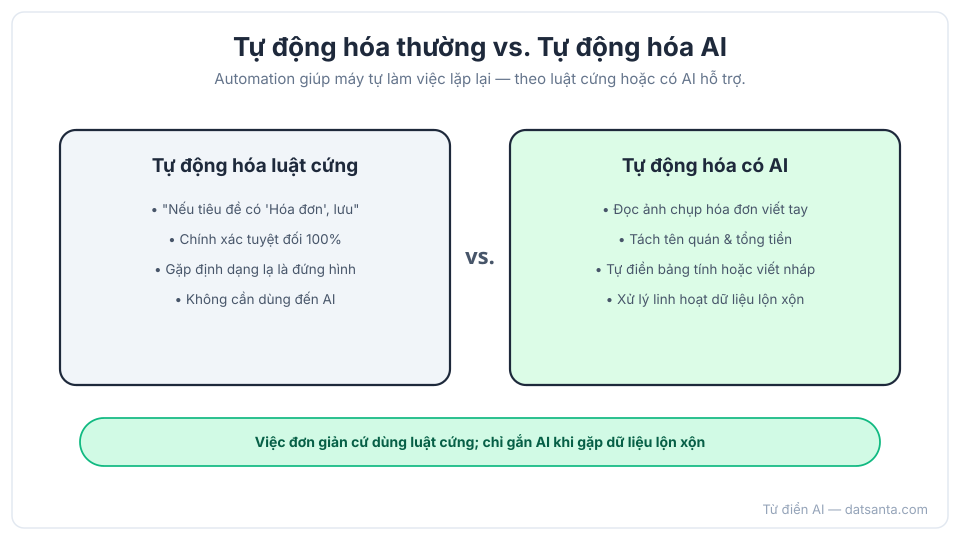

# Automation (Tự động hóa)

**Automation** là việc dùng phần mềm hoặc máy móc để tự thực hiện các công việc lặp đi lặp lại với ít hoặc không cần con người can thiệp — theo quy tắc cố định hoặc có AI hỗ trợ.

## Ví dụ thực tế

Hẹn giờ máy pha cà phê tự chạy lúc 7 giờ sáng mỗi ngày, hay cài bộ lọc để Gmail tự chuyển mọi hóa đơn vào thư mục riêng chính là tự động hóa quen thuộc.

Tự động hóa truyền thống xử lý các quy tắc rạch ròi (*"Nếu thấy X, làm Y"*). Khi kết hợp thêm AI, hệ thống xử lý được cả dữ liệu lộn xộn — như đọc ảnh chụp hóa đơn viết tay rồi tự điền số tiền vào bảng tính.

## Đừng nhầm với

- **[AI](ai.md):** Phần lớn tự động hóa hằng ngày (email trả lời tự động, sao lưu định kỳ, cánh tay lắp ráp nhà máy) chạy theo luật cứng và hoàn toàn không dùng AI.
- **[AI workflow](ai-workflow.md):** AI workflow là dạng tự động hóa hiện đại có nối thêm [LLM](llm.md) vào giữa các ứng dụng để tóm tắt, phân loại hay viết nháp.

## Thuật ngữ liên quan

- [AI Workflow](ai-workflow.md)
- [Algorithm](algorithm.md)
- [AI Agent](ai-agent.md)
- [AI](ai.md)
