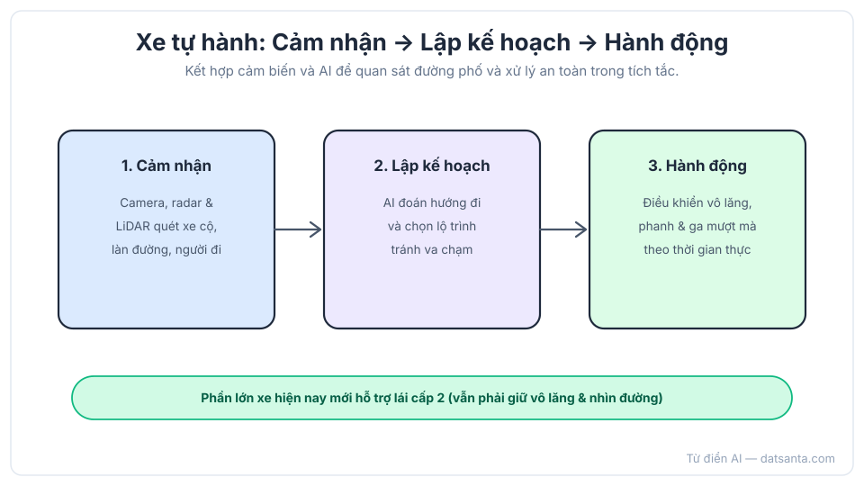

# Autonomous Vehicle (Xe tự hành)

**Autonomous vehicle** (ô tô tự lái, drone hoặc robot giao hàng) sử dụng camera, radar, cảm biến và AI để quan sát môi trường xung quanh, lên lộ trình an toàn và di chuyển với rất ít hoặc không cần người lái.

## Ví dụ thực tế

Đi qua một ngã tư đông đúc đòi hỏi phải nhìn thấy người đi bộ, đọc đèn giao thông, đoán xem xe máy bên cạnh có tạt đầu không và đánh lái mượt mà — tất cả chỉ trong tích tắc.

Xe tự hành chạy vòng lặp liên tục **Cảm nhận → Lập kế hoạch → Hành động**: [computer vision](computer-vision.md) và LiDAR dựng bản đồ 3D mặt đường, AI dự đoán hướng đi các xe quanh đó, còn máy tính trên xe điều khiển vô lăng, phanh và ga.

## Đừng nhầm với

- **Ga tự động (Cruise control):** Cruise control chỉ giữ tốc độ trên cao tốc vắng; xe tự hành tự đánh lái, dừng đèn đỏ và né chướng ngại vật bất ngờ.
- **Tự lái mọi nơi (Cấp độ 5):** Phần lớn xe hiện nay mới hỗ trợ lái cấp 2 (vẫn giữ tay lái), còn taxi tự lái mới chạy trong vùng bản đồ định sẵn.

## Thuật ngữ liên quan

- [Computer Vision](computer-vision.md)
- [AI Agent](ai-agent.md)
- [Deep Learning](deep-learning.md)
- [Local AI](local-ai.md)
