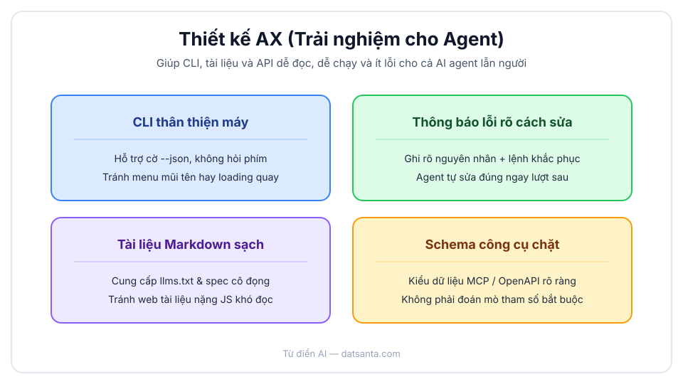

# AX (Trải nghiệm cho Agent — Agent Experience)

**AX (Agent Experience)** đo mức độ dễ dàng, rõ ràng và ổn định khi các AI agent—chứ không chỉ lập trình viên người thật—đọc tài liệu, chạy công cụ CLI, phân tích thông báo lỗi và gọi API của bạn mà không bị kẹt.

## Ví dụ thực tế

DX (Developer Experience) tốt thường thêm hiệu ứng vòng xoay loading đẹp mắt và menu chọn bằng phím mũi tên cho CLI. Chính những menu tương tác đó lại hay làm *kẹt cứng* coding agent! AX tốt cung cấp cờ `--json` không tương tác, tài liệu Markdown gọn sạch (như `llms.txt`), thông báo lỗi chỉ rõ cách sửa và schema [MCP](mcp.md) mạch lạc để cả người lẫn agent chạy trúng ngay lần đầu.

## Đừng nhầm với

- **[MCP (Model Context Protocol)](mcp.md):** MCP là một giao thức kỹ thuật cụ thể để kết nối công cụ cho agent; AX là triết lý thiết kế rộng hơn bao trùm từ đầu ra CLI, tài liệu, thông báo lỗi đến cấu trúc API thân thiện với agent.

## Thuật ngữ liên quan

- [MCP](mcp.md)
- [AGENTS.md](agents-md.md)
- [Structured Outputs](structured-outputs.md)
