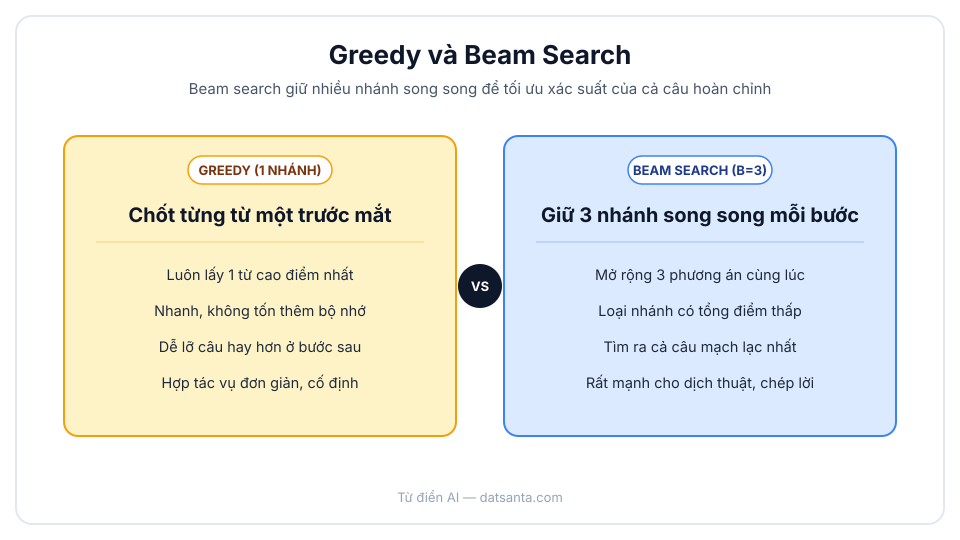

# Beam Search (Tìm kiếm chùm)

**Beam search** là chiến lược giải mã theo dõi đồng thời `B` chuỗi ứng viên triển vọng nhất ở mỗi bước thay vì chốt vội một token đơn lẻ, từ đó chọn ra cả câu có tổng xác suất cao nhất.

## Ví dụ thực tế

Khi leo núi không có bản đồ, chỉ đi theo con dốc đứng nhất ngay trước mắt có thể dẫn bạn vào ngõ cụt trên một mỏm đá thấp. Cử 3 trinh sát đi theo 3 lối hứa hẹn nhất (`beam width = 3`) và giữ lại những nhánh đường mạnh nhất về tổng thể giúp tránh bẫy cục bộ. Beam search rất mạnh trong dịch thuật hay nhận dạng giọng nói, còn chatbot thường ưu tiên [temperature](temperature.md) để câu chữ tự nhiên hơn.

## Đừng nhầm với

- **[Top-k Sampling](top-k-sampling.md):** Top-k bốc thăm ngẫu nhiên một token từ `k` ứng viên; beam search tìm kiếm có hệ thống qua nhiều nhánh song song để tối ưu điểm số cả câu.

## Thuật ngữ liên quan

- [Top-k Sampling](top-k-sampling.md)
- [Temperature](temperature.md)
- [Logits](logits.md)
