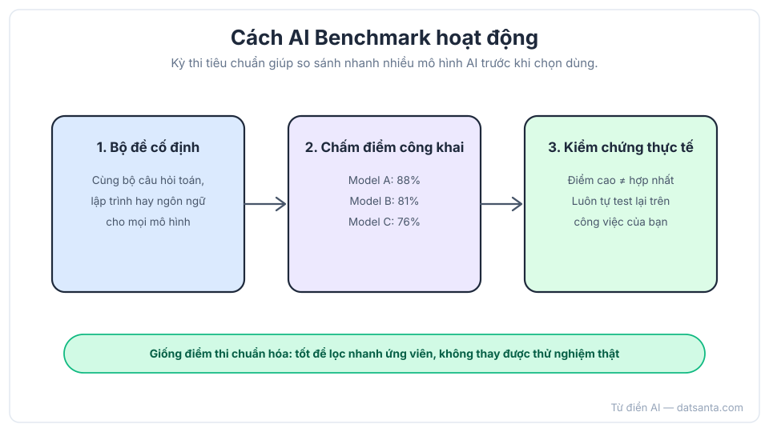

# Benchmark (Bài kiểm tra chuẩn)

**Benchmark** là một kỳ thi tiêu chuẩn — gồm bộ đề cố định về toán, lập trình, ngôn ngữ hoặc suy luận — dùng để chấm điểm và so sánh năng lực giữa các mô hình AI với nhau.

## Ví dụ thực tế

Hãy nghĩ đến điểm thi đại học hay xếp hạng an toàn va chạm của ô tô. Chúng cho bạn cái nhìn nhanh để so sánh hai mô hình (ví dụ Model A đạt 88% còn Model B đạt 81% ở bài thi viết code) trước khi tự dùng thử.

Tuy nhiên, giống như học sinh học tủ đề thi cũ, một mô hình AI có thể đạt điểm rất cao trên benchmark công khai nhưng vẫn làm chưa mượt công việc cụ thể của *bạn*. Luôn tự thử trên dữ liệu thật của mình.

## Đừng nhầm với

- **[Evals](evals.md):** Benchmark công khai so sánh mô hình tổng quát trên đề thi chung; *evals* là bộ bài kiểm tra riêng bạn tự tạo để đo hiệu quả trên đúng ứng dụng của mình.
- **Hiệu quả ngoài đời thực:** Mô hình đứng #1 ở bài thi toán học thuật chưa chắc là mô hình viết tiếng Việt tự nhiên nhất hay có chi phí hợp lý nhất cho công việc hằng ngày.

## Thuật ngữ liên quan

- [Evals](evals.md)
- [Dataset](dataset.md)
- [LLM](llm.md)
- [Reasoning Model](reasoning-model.md)
