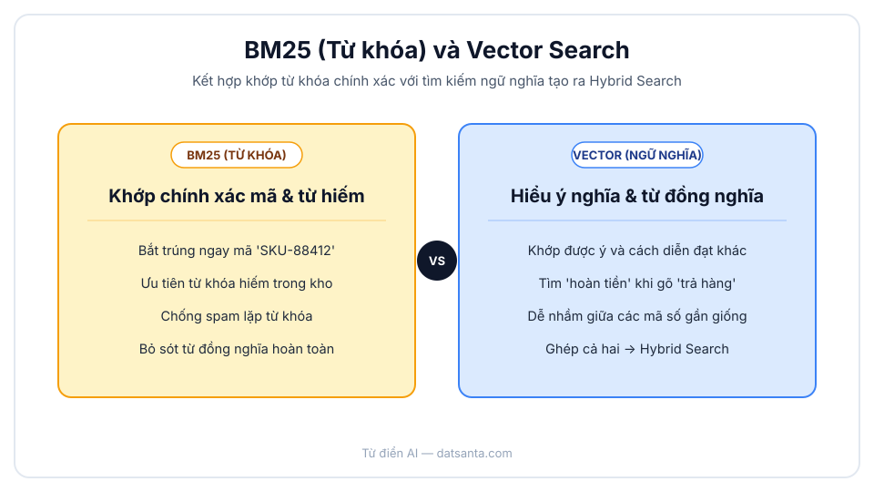

# BM25 (Tìm kiếm từ khóa chuẩn)

**BM25** là thuật toán xếp hạng tìm kiếm từ khóa kinh điển, tốc độ cao, chấm điểm tài liệu theo độ khớp chính xác từng từ đồng thời ưu tiên từ khóa hiếm và chặn việc nhồi lặp từ để gian lận điểm.

## Ví dụ thực tế

Giả sử bạn tìm trong danh mục linh kiện cụm `"gioăng SKU-88412"`. Tìm kiếm ngữ nghĩa bằng [embeddings](embeddings.md) dễ coi `"SKU-88412"` và `"SKU-88419"` gần như giống hệt nhau, trong khi BM25 bắt trúng ngay mã hiếm `"SKU-88412"` và đẩy đúng trang tài liệu đó lên hạng 1. Kết hợp BM25 với tìm kiếm vector sẽ tạo ra [hybrid search](hybrid-search.md)—vừa chuẩn mã chính xác vừa hiểu được ý nghĩa.

## Đừng nhầm với

- **[Cosine Similarity](cosine-similarity.md):** Cosine similarity so sánh vector ngữ nghĩa để bắt từ đồng nghĩa; BM25 đếm chính xác từ khóa xuất hiện và độ hiếm của từ trong kho tài liệu.

## Thuật ngữ liên quan

- [Hybrid Search](hybrid-search.md)
- [Vector Database](vector-database.md)
- [Reranking](reranking.md)
