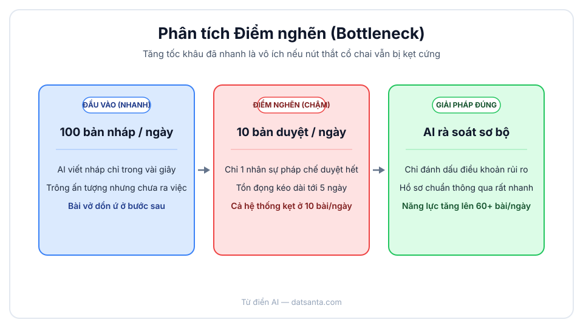

# Bottleneck Analysis (Phân tích điểm nghẽn)

**Bottleneck analysis** là việc tìm ra đúng khâu chậm nhất hoặc quá tải nhất đang kéo lùi cả quy trình, từ đó đặt AI vào đúng chỗ để tăng tốc toàn bộ hệ thống.

## Ví dụ thực tế

Nếu một cao tốc có 4 làn xe thoáng đãng nhưng bỗng thắt lại chỉ còn 1 trạm thu phí, việc mở rộng đoạn 4 làn lên 8 làn cũng không giúp xe về nhà nhanh hơn. Bạn bắt buộc phải xử lý trạm thu phí. Tương tự, dùng AI viết bài marketing nhanh gấp 3 lần sẽ vô ích nếu bài viết vẫn phải nằm chờ 5 ngày để một nhân sự pháp chế duyệt. Hãy luôn dùng AI giải tỏa nút thắt cổ chai trước.

## Đừng nhầm với

- **[Process Mapping](process-mapping.md):** Process mapping vẽ toàn bộ con đường từ đầu đến cuối; bottleneck analysis chỉ điểm chính xác đoạn kẹt xe nghiêm trọng nhất trên con đường đó.

## Thuật ngữ liên quan

- [Use Case Prioritization](use-case-prioritization.md)
- [AI Strategy](ai-strategy.md)
- [AI KPI](ai-kpi.md)
