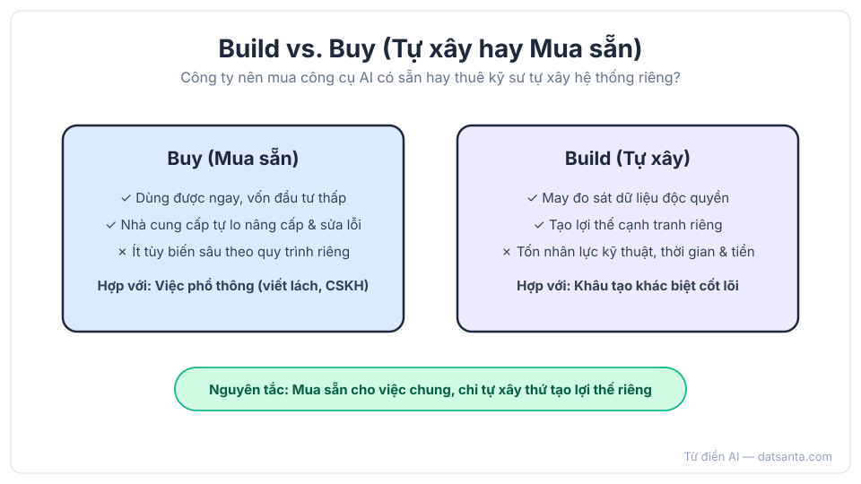

# Build vs. Buy (Tự xây hay Mua sẵn)

**Build vs. Buy** là quyết định kinh doanh giữa việc mua một công cụ AI có sẵn trên thị trường hay thuê đội ngũ kỹ sư tự xây dựng một hệ thống riêng xoay quanh dữ liệu của công ty bạn.

## Ví dụ thực tế

Một công ty đang mở rộng cần xe giao hàng. Mua hoặc thuê xe có sẵn giúp bạn chạy được ngay ngày mai với chi phí dễ đoán. Tự thiết kế và sản xuất xe từ đầu chỉ hợp lý nếu bản thân chiếc xe là sản phẩm cốt lõi của bạn.

Phần lớn doanh nghiệp nên **mua sẵn** công cụ AI cho các việc phổ thông (tóm tắt cuộc họp, viết nội dung, hỗ trợ cơ bản) và chỉ **tự xây** ở những khâu dùng dữ liệu độc quyền tạo ra lợi thế cạnh tranh thật sự.

## Đừng nhầm với

- **[Fine-tuning](fine-tuning.md):** Fine-tuning là tinh chỉnh hành vi của một mô hình có sẵn; còn build vs. buy là lựa chọn bài toán sở hữu phần mềm hay thuê dịch vụ ngoài.
- **[Vendor lock-in](vendor-lock-in.md):** Mua sẵn giúp đi nhanh, nhưng phụ thuộc hoàn toàn vào một nhà cung cấp khép kín sẽ khiến bạn khó chuyển đổi về sau.

## Thuật ngữ liên quan

- [AI ROI](ai-roi.md)
- [Vendor Lock-in](vendor-lock-in.md)
- [Fine-tuning](fine-tuning.md)
