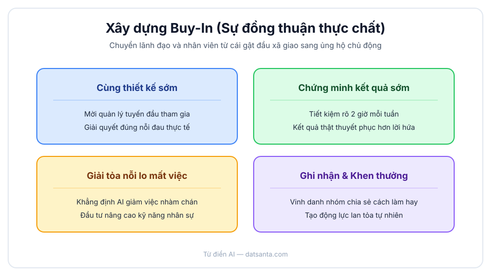

# Buy-In (Sự đồng thuận & ủng hộ)

**Buy-in** là sự đồng thuận thực chất và ủng hộ chủ động từ ban lãnh đạo, quản lý cấp trung đến nhân viên tuyến đầu dành cho một dự án AI—không chỉ là cái gật đầu xã giao trong buổi họp khởi động.

## Ví dụ thực tế

Giám đốc có thể tuyên bố "năm nay là năm AI" trên sân khấu, nhưng mọi thứ vẫn giậm chân tại chỗ nếu quản lý phòng ban ngầm lo mất vị trí hoặc nhân viên thấy công cụ mới làm tốn thêm việc. Buy-in thật sự xuất hiện khi trưởng nhóm được tham gia thiết kế thử nghiệm, thấy rõ AI giúp bỏ bớt giấy tờ nhàm chán và chủ động khuyến khích cả đội dùng đều mỗi tuần.

## Đừng nhầm với

- **[AI Adoption](ai-adoption.md):** Buy-in là sự sẵn lòng về mặt tinh thần và niềm tin ủng hộ thay đổi; AI adoption là tỷ lệ sử dụng thực tế đo được sau khi mọi người đã đồng thuận.

## Thuật ngữ liên quan

- [Change Management](change-management.md)
- [AI Champion](ai-champion.md)
- [AI Strategy](ai-strategy.md)
