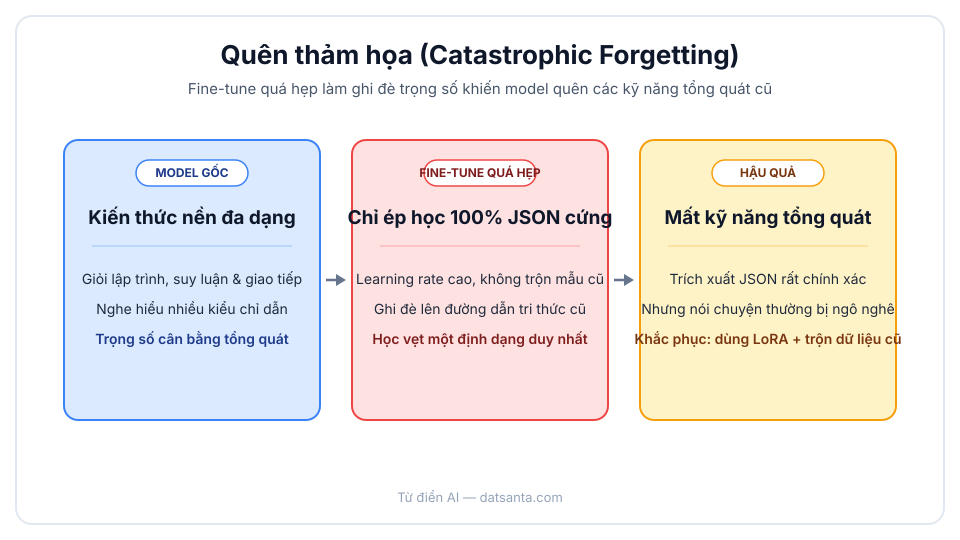

# Catastrophic Forgetting (Quên thảm họa)

**Catastrophic forgetting** xảy ra khi việc fine-tune model trên một tập dữ liệu mới quá hẹp làm ghi đè trọng số cũ, khiến model đột ngột quên mất khả năng suy luận, viết code hay giao tiếp tổng quát mà nó từng biết.

## Ví dụ thực tế

Hãy tưởng tượng một hướng dẫn viên song ngữ suốt ba tháng chỉ làm mỗi việc đọc văn bản pháp lý cứng nhắc ở tòa án, rồi bỗng lúng túng không nói chuyện tự nhiên được nữa. Nếu bạn fine-tune LLM chỉ bằng 5.000 mẫu trích xuất JSON khô khan với learning rate cao, nó sẽ xuất JSON cực giỏi nhưng quên luôn cách trò chuyện lịch sự. Trộn thêm dữ liệu tổng quát hoặc dùng [LoRA](lora.md) giúp tránh lỗi này.

## Đừng nhầm với

- **Overfitting:** Overfitting là học vẹt tập huấn luyện nên kém trên dữ liệu kiểm thử mới của *cùng bài toán đó*; catastrophic forgetting là đánh mất *những kỹ năng khác đã học từ trước*.

## Thuật ngữ liên quan

- [Fine-tuning](fine-tuning.md)
- [LoRA](lora.md)
- [Regression Testing](regression-testing.md)
