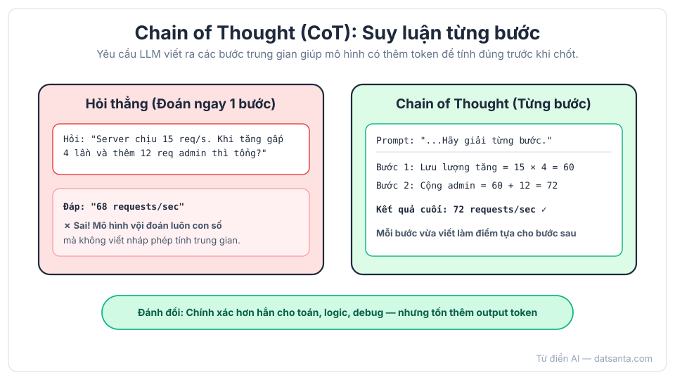

# Chain of Thought (Suy luận từng bước)

**Chain of thought (CoT)** là kỹ thuật yêu cầu [LLM](llm.md) viết ra các bước suy luận trung gian trước khi chốt đáp án cuối, giúp tăng rõ rệt độ chính xác ở bài toán logic, tính toán và debug code nhiều bước.

## Ví dụ đời thường

Nếu ai đó hỏi *"15 × 4 + 12 bằng bao nhiêu?"* và bắt bạn hô ngay một con số trong 1 giây, bạn rất dễ tính nhẩm nhầm. Ghi ra nháp *"Bước 1: 15 × 4 = 60. Bước 2: 60 + 12 = 72"* giúp tránh sai sót ngớ ngẩn.

Vì LLM chỉ "suy nghĩ" thông qua việc sinh từng [token](token.md), ép nó trả lời thẳng 1 từ sẽ bóp nghẹt khả năng tính toán. Cho phép viết từng bước sẽ đặt kết quả trung gian vào ngay [context window](context-window.md) để dẫn đường cho đáp án cuối.

## Đừng nhầm với

- **Hỏi đáp trực tiếp:** Chỉ lấy đáp án cuối; rẻ và nhanh hơn cho câu tra cứu đơn giản, nhưng hay sai ở bài toán nhiều bước.
- **Thinking tokens ẩn:** Các "reasoning model" đời mới tự động sinh chuỗi suy luận ngầm trước khi stream câu trả lời ra màn hình.

## Thuật ngữ liên quan

- [Prompt](prompt.md)
- [ReAct Pattern](react-pattern.md)
- [Context Window](context-window.md)
- [Token](token.md)
