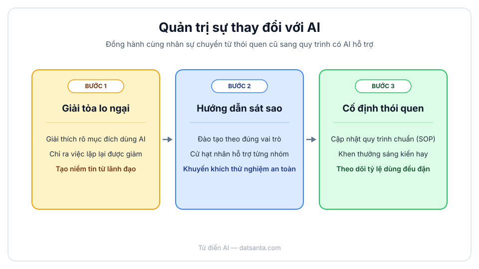

# Change Management (Quản trị sự thay đổi)

**Change management** là quá trình chuẩn bị, truyền thông và đồng hành cùng nhân sự khi đưa AI vào quy trình làm việc, giúp mọi người hiểu rõ lợi ích, bớt lo lắng và hình thành thói quen làm việc mới.

## Ví dụ thực tế

Nếu ban giám đốc đột ngột áp dụng một phần mềm chấm công và báo cáo mới mà không giải thích lý do hay hướng dẫn cách dùng, nhân viên dễ phản ứng bằng cách làm đối phó hoặc quay lại file Excel cũ. Khi triển khai AI cũng vậy: lắng nghe nỗi lo bị thay thế, chỉ rõ AI giúp giảm việc lặp lại nhàm chán thế nào và cử người hỗ trợ trực tiếp trong những tuần đầu quyết định 70% thành công của dự án.

## Đừng nhầm với

- **[AI Enablement](ai-enablement.md):** Enablement tập trung vào công cụ, tài liệu mẫu và đào tạo kỹ năng dùng AI; change management lo khía cạnh tâm lý, quy trình và sự đồng thuận của con người.

## Thuật ngữ liên quan

- [AI Adoption](ai-adoption.md)
- [Productivity J-Curve](productivity-j-curve.md)
- [AI Enablement](ai-enablement.md)
