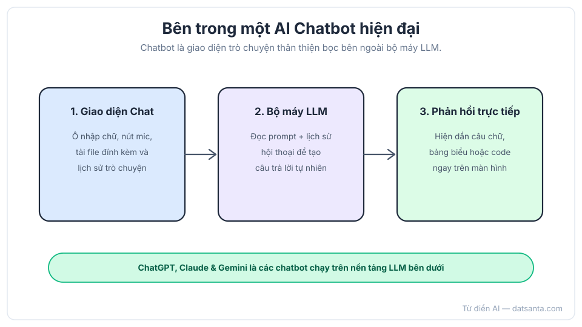

# Chatbot

**Chatbot** là ứng dụng có giao diện trò chuyện nơi bạn gõ chữ hoặc nói câu hỏi và nhận lại câu trả lời tự nhiên từ mô hình AI (như ChatGPT, Claude hoặc Gemini).

## Ví dụ thực tế

Chatbot thế hệ cũ trên các trang web giống như tổng đài tự động: bấm phím 1 hỏi giao hàng, bấm phím 2 hỏi hóa đơn — gõ ngoài kịch bản là nó đáp *"Xin lỗi, tôi không hiểu."*

AI chatbot hiện đại chạy trên [LLM](llm.md) có thể hiểu câu hỏi mở, nhớ các tin nhắn trước trong cuộc trò chuyện, tóm tắt file bạn gửi lên và đối đáp tự nhiên qua lại.

## Đừng nhầm với

- **[LLM](llm.md):** LLM là bộ não AI chạy trên máy chủ; chatbot là khung cửa sổ chat, nút bấm và lịch sử hội thoại bọc quanh bộ não đó.
- **[AI agent](ai-agent.md):** Chatbot chủ yếu trò chuyện và viết nháp giúp bạn; AI agent có thể tự lập kế hoạch và thao tác trực tiếp trên các ứng dụng thay bạn.

## Thuật ngữ liên quan

- [LLM](llm.md)
- [Copilot](copilot.md)
- [AI Agent](ai-agent.md)
- [Prompt](prompt.md)
