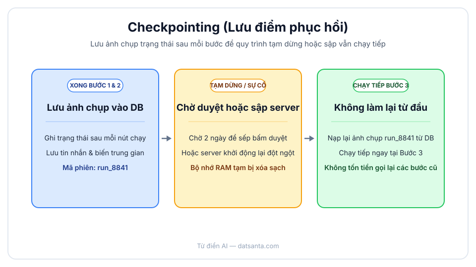

# Checkpointing (Lưu điểm phục hồi trạng thái)

**Checkpointing** lưu lại toàn bộ ảnh chụp trạng thái của agent—lịch sử tin nhắn, biến số và bước đang đứng—vào cơ sở dữ liệu sau mỗi nút chạy, giúp quy trình dài có thể tạm dừng, vượt qua sự cố sập server hoặc chạy tiếp nhiều ngày sau.

## Ví dụ thực tế

Game nhập vai luôn tự động lưu điểm checkpoint trước khi đánh trùm để mất điện giữa chừng không bị đẩy ngược về Màn 1. Với agent chạy thực tế, nếu quy trình cần tạm dừng chờ sếp bấm duyệt trên Slack hoặc container bị khởi động lại giữa chừng, checkpointing cho phép [state machine](state-machine.md) nạp lại đúng ảnh chụp đã lưu và chạy tiếp từ bước 4 thay vì tốn tiền gọi lại từ đầu.

## Đừng nhầm với

- **[Agent Memory](agent-memory.md):** Agent memory ghi nhớ thông tin hay sở thích người dùng qua *nhiều cuộc trò chuyện khác nhau*; checkpointing lưu ảnh chụp thực thi chính xác để khôi phục *một phiên chạy cụ thể*.

## Thuật ngữ liên quan

- [State Machine](state-machine.md)
- [Human-in-the-Loop](human-in-the-loop.md)
- [Idempotency](idempotency.md)
