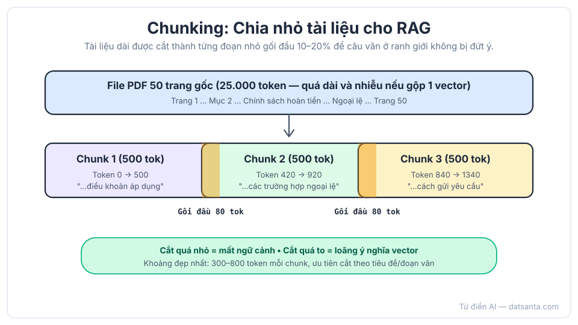

# Chunking (Chia nhỏ tài liệu)

**Chunking** là bước cắt các tài liệu dài (như file PDF 50 trang hay mã nguồn dự án) thành những đoạn nhỏ gọn trước khi tạo [embeddings](embeddings.md) cho [RAG](rag.md), thường kèm 10–20% phần gối đầu giữa các đoạn liền kề.

## Ví dụ đời thường

Nếu bạn xay nhuyễn cả cuốn sách dạy nấu ăn thành đúng 1 vector, khi tìm `"nước sốt mì Ý"` kết quả sẽ rất nhiễu. Hãy cắt sách thành từng công thức riêng dài 300–800 [token](token.md), mỗi truy vấn sẽ trúng phóc đúng món bạn cần.

Việc thêm phần gối đầu (ví dụ 80 token lặp lại giữa Chunk 1 và Chunk 2) bảo đảm một quy định quan trọng nằm ngay ranh giới trang không bị chặt đứt làm đôi.

## Đừng nhầm với

- **[Tokenization](token.md):** Tokenization tách chữ thành mảnh từ nhỏ để mô hình đọc; chunking cắt cả tài liệu lớn thành từng khối đoạn văn để tra cứu.
- **Cắt cứng theo số ký tự:** Cắt máy móc mỗi 1.000 ký tự rất dễ làm gãy giữa câu hoặc giữa bảng; bộ cắt thông minh ưu tiên tách theo tiêu đề Markdown và hết đoạn.

## Thuật ngữ liên quan

- [RAG](rag.md)
- [Embeddings](embeddings.md)
- [Vector Database](vector-database.md)
- [Context Window](context-window.md)
