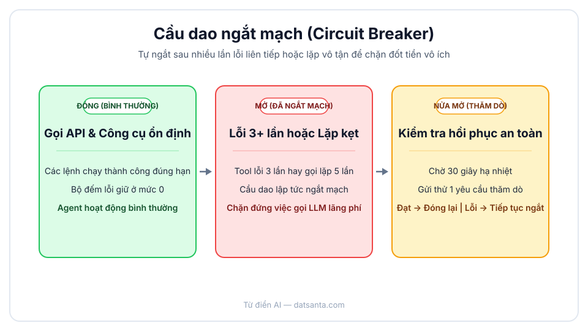

# Circuit Breaker (Cầu dao ngắt mạch)

**Circuit breaker** là cơ chế bảo vệ độ ổn định giúp ngăn ứng dụng AI hoặc agent gọi lặp đi lặp lại vào một API đang hỏng hay kẹt trong vòng lặp vô tận—tự động ngắt mạch sau `N` lần lỗi liên tiếp để báo lỗi nhanh hoặc chuyển hướng an toàn.

## Ví dụ thực tế

Khi máy nướng bánh mì trong bếp bị chập điện, cầu dao tổng lập tức nhảy ngắt điện thay vì để dây nóng chảy gây cháy nhà. Trong code agent, nếu một công cụ CRM bên ngoài trả lỗi `503` năm lần liền—hoặc agent gọi đúng một hàm tìm kiếm 8 lần với tham số y hệt—circuit breaker sẽ cắt ngay vòng lặp, cứu ứng dụng khỏi tốn thời gian chờ và đốt sạch tiền token.

## Đừng nhầm với

- **[Rate Limiting](rate-limiting.md):** Rate limiting giới hạn số lượt gọi tối đa mỗi phút khi hệ thống chạy bình thường; circuit breaker phát hiện *chuỗi lỗi lặp hoặc vòng lặp kẹt* để ngắt hẳn cho tới khi dịch vụ hồi phục.

## Thuật ngữ liên quan

- [Fallback Chain](fallback-chain.md)
- [State Machine](state-machine.md)
- [Token Budget](token-budget.md)
