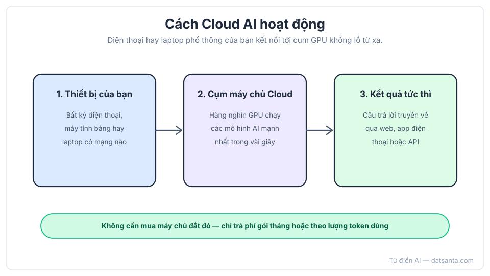

# Cloud AI (AI đám mây)

**Cloud AI** là cách sử dụng các mô hình AI mạnh mẽ được đặt trên trung tâm dữ liệu từ xa qua internet — thông qua trang web, ứng dụng di động hoặc API — thay vì chạy trên máy tính cá nhân của bạn.

## Ví dụ thực tế

Giống như xem phim trực tuyến trên Netflix hay lưu file trên Google Drive, bạn không cần bỏ hàng trăm triệu mua GPU máy chủ để dùng những mô hình AI thông minh nhất. Bạn chỉ cần gõ [prompt](prompt.md) trên chiếc điện thoại hay laptop bình thường, cụm máy chủ từ xa tính toán trong vài giây rồi gửi kết quả về.

Đánh đổi là bạn cần có mạng, trả phí gói tháng hoặc theo [token](token.md), và cần đọc kỹ chính sách [data privacy](data-privacy.md) của nhà cung cấp.

## Đừng nhầm với

- **[Local AI](local-ai.md):** Local AI chạy ngoại tuyến ngay trên thiết bị cá nhân; cloud AI chạy trên cụm GPU từ xa của nhà cung cấp.
- **Lưu trữ đám mây:** Lưu file PDF trên Google Drive chỉ là cất giữ tài liệu; cloud AI thực sự chạy quá trình [inference](inference.md) của mô hình trên máy chủ đám mây.

## Thuật ngữ liên quan

- [Local AI](local-ai.md)
- [Open-Source AI](open-source-ai.md)
- [Data Privacy](data-privacy.md)
- [Inference](inference.md)
