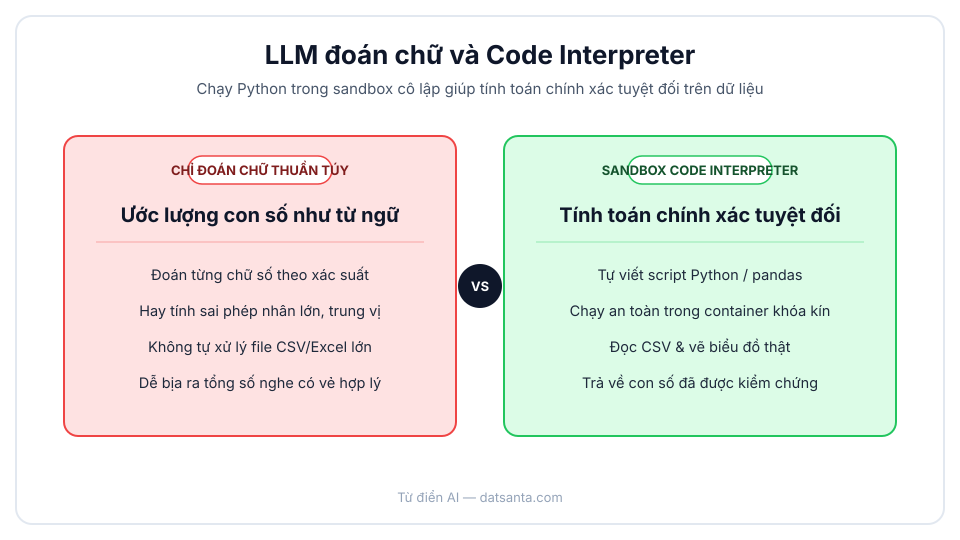

# Code Interpreter (Trình thông dịch Code an toàn)

**Code interpreter** là công cụ [sandbox](sandbox.md) an toàn, cô lập gắn kèm cho LLM, cho phép model tự viết và chạy code Python hoặc lệnh shell ngay lập tức để tính toán chính xác, phân tích file CSV hay vẽ biểu đồ.

## Ví dụ thực tế

Nhờ một model ngôn ngữ thuần túy nhân hai số 8 chữ số hay tìm trung vị của 5.000 dòng Excel bằng cách đoán từng token rất dễ sai số học. Khi có code interpreter, LLM tự viết đoạn script `pandas` dài 5 dòng, chạy trong container bị khóa kín, đọc kết quả tính chính xác (`142.890,50 USD`) và trả lời bằng con số đã kiểm chứng thay vì đoán mò.

## Đừng nhầm với

- **[Computer Use](computer-use.md):** Computer use bấm chuột thao tác trên màn hình desktop có giao diện đồ họa; code interpreter chạy script dòng lệnh không giao diện trong sandbox và trả về kết quả đầu ra hoặc file tạo mới.

## Thuật ngữ liên quan

- [Sandbox](sandbox.md)
- [Function Calling](function-calling.md)
- [Hallucination](hallucination.md)
