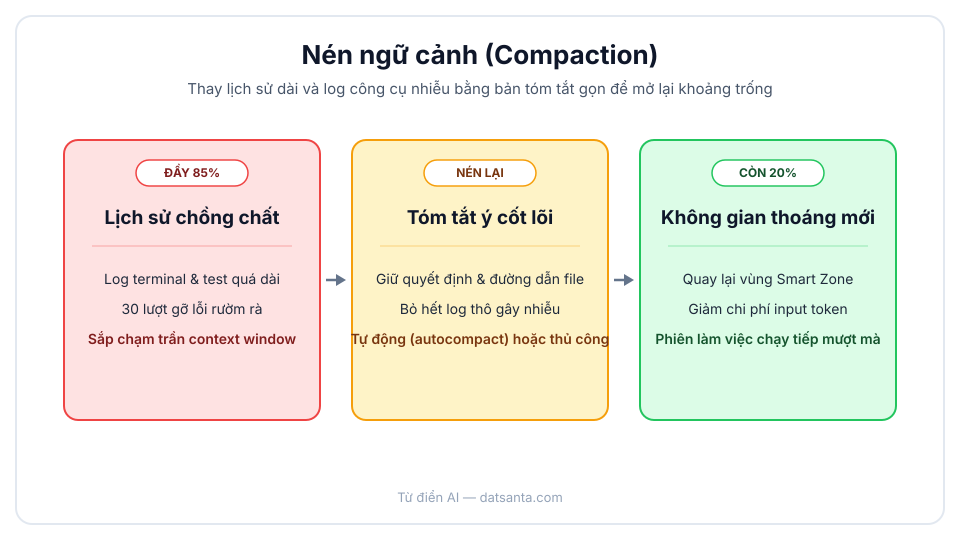

# Compaction (Nén ngữ cảnh)

**Compaction** là việc tóm tắt và thay thế các lượt trò chuyện cũ, log công cụ và nội dung file dài trong một phiên lập trình AI bằng một bản tóm lược gọn nhẹ để tiếp tục làm việc mà không tràn [context window](context-window.md).

## Ví dụ thực tế

Hãy hình dung chiếc bảng trắng viết kín đặc sau ba tiếng gỡ lỗi với đủ loại log báo lỗi và giả thuyết sai. Trước khi hết chỗ viết, bạn chép lại 5 gạch đầu dòng kết luận quan trọng nhất rồi lau sạch phần còn lại của bảng để đầu óc sáng suốt trở lại. Nhiều coding [harness](harness.md) còn tự động chạy **autocompact** khi ngữ cảnh chạm ngưỡng ~80%, đổi lịch sử chi tiết lấy khoảng trống làm việc mới.

## Đừng nhầm với

- **[Handoff Artifact](handoff-artifact.md):** Compaction nén lịch sử ngay bên trong *cùng một phiên đang chạy*; handoff artifact ghi bản tóm tắt ra file để đóng hẳn phiên cũ và mở một *phiên mới tinh* sạch nhiễu.

## Thuật ngữ liên quan

- [Smart Zone](smart-zone.md)
- [Context Rot](context-rot.md)
- [Harness](harness.md)
