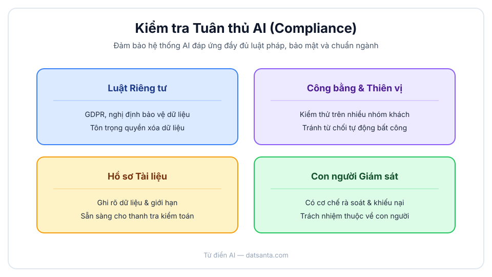

# Compliance (Tuân thủ quy định)

**Compliance** là việc đảm bảo công cụ AI, cách xử lý dữ liệu và các quyết định tự động của doanh nghiệp tuân thủ đúng pháp luật, tiêu chuẩn ngành và cam kết trong hợp đồng với khách hàng.

## Ví dụ thực tế

Một nhà hàng không chỉ cần nấu ăn ngon mà còn phải đạt chứng nhận vệ sinh an toàn thực phẩm, ghi rõ thành phần gây dị ứng và đảm bảo phòng cháy chữa cháy. Tương tự, ngân hàng hay phòng khám không thể đưa AI chấm điểm tín dụng hoặc phân loại bệnh nhân vào chạy thật chỉ vì thấy nó chính xác, mà phải chứng minh hệ thống tuân thủ luật bảo mật, không thiên vị và lưu đủ hồ sơ kiểm tra.

## Đừng nhầm với

- **[Data Governance](data-governance.md):** Data governance là cách bạn tự sắp xếp và kiểm soát dữ liệu bên trong; compliance là việc chứng minh doanh nghiệp đáp ứng đúng luật lệ bên ngoài.

## Thuật ngữ liên quan

- [EU AI Act](eu-ai-act.md)
- [Audit Trail](audit-trail.md)
- [Model Risk Management](model-risk-management.md)
