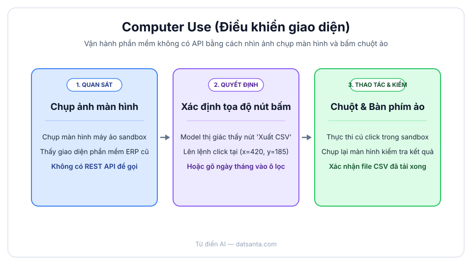

# Computer Use (Điều khiển giao diện máy tính)

**Computer use** là khả năng của model đa phương thức khi nhìn ảnh chụp màn hình giao diện đồ họa (GUI) và trực tiếp điều khiển chuột, bàn phím ảo—bấm nút, gõ chữ, cuộn trang hệt như nhân viên thao tác trên máy tính.

## Ví dụ thực tế

Rất nhiều phần mềm doanh nghiệp đời cũ (ERP cũ, phần mềm kế toán desktop hay cổng đối tác) không hề có REST API hay cổng [MCP](mcp.md). Thay vì bó tay, agent computer-use chụp màn hình, nhận ra nút `"Xuất CSV"` ở tọa độ `(420, 185)`, bấm vào đó bên trong một [sandbox](sandbox.md) cô lập và kiểm tra màn hình tiếp theo—tự động hóa được cả những phần mềm vốn chỉ làm cho mắt người dùng.

## Đừng nhầm với

- **[Function Calling](function-calling.md):** Function calling gọi thẳng API backend qua JSON có cấu trúc (nhanh và ổn định); computer use nhìn điểm ảnh trên màn hình để bấm chuột khi hệ thống không có API.

## Thuật ngữ liên quan

- [Sandbox](sandbox.md)
- [Function Calling](function-calling.md)
- [AI Agent](ai-agent.md)
