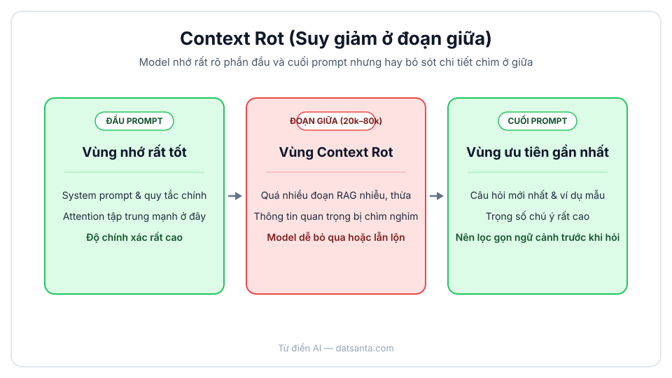

# Context Rot (Suy giảm ngữ cảnh)

**Context rot** (thường gọi là hiện tượng "lạc giữa dòng" — *lost in the middle*) là sự suy giảm dần độ chính xác suy luận và khả năng tuân thủ chỉ dẫn của LLM khi prompt bị nhồi quá dài và nhiễu—ngay cả khi chưa chạm trần token tối đa.

## Ví dụ thực tế

Dù phòng họp đủ chỗ cho 50 người, việc họp bàn quyết định quan trọng với 48 người nói xen kẽ nhau sẽ khiến ai cũng bỏ sót chi tiết nằm ở phút thứ 35. LLM cũng vậy: chúng nhớ rất tốt thông tin ở đầu và cuối prompt, nhưng dễ bỏ qua dữ kiện nằm chìm ở đoạn giữa trong chuỗi 60.000 token. Cắt gọn lịch sử chat cũ và lọc kỹ đoạn [RAG](rag.md) giúp tránh context rot.

## Đừng nhầm với

- **[Context Window](context-window.md):** Context window là giới hạn dung lượng kỹ thuật tối đa model nhận được; context rot là sự tụt chất lượng thực tế xảy ra trước khi chạm giới hạn đó.

## Thuật ngữ liên quan

- [Needle-in-a-Haystack Test](needle-in-a-haystack.md)
- [Context Window](context-window.md)
- [Reranking](reranking.md)
