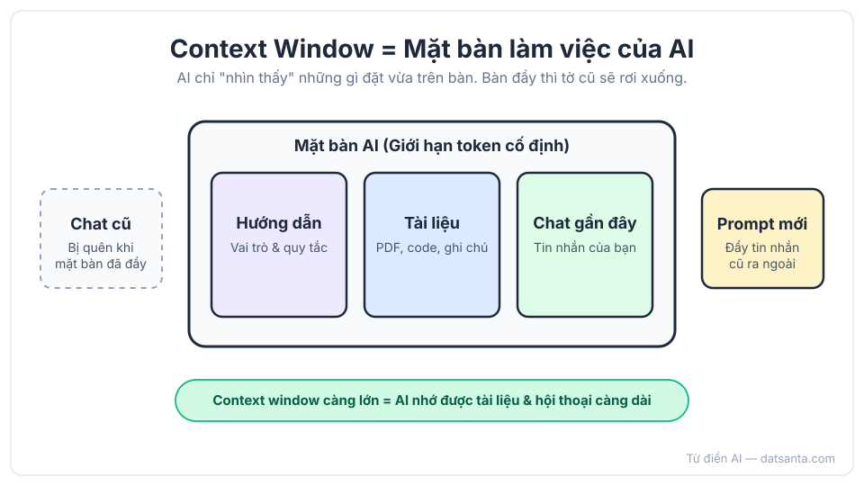

# Context Window (Cửa sổ ngữ cảnh)

**Context window** là lượng văn bản tối đa (tính bằng [token](token.md)) mà AI có thể "nhớ" cùng lúc trong một cuộc trò chuyện. Mọi thông tin vượt quá giới hạn này sẽ bị đẩy ra ngoài và AI không còn thấy nữa.

## Ví dụ đời thường

Hãy hình dung context window giống như mặt bàn làm việc của AI. Hướng dẫn ban đầu, file PDF bạn gửi lên và các tin nhắn gần đây đều được trải trên mặt bàn đó.

Nếu bạn trò chuyện quá dài hoặc thả vào một cuốn sách dày, mặt bàn sẽ chật kín. Để đặt câu hỏi mới lên bàn, những tờ giấy cũ nhất sẽ bị trượt rơi xuống đất — đó là lý do đôi khi AI quên mất điều bạn dặn từ 30 tin nhắn trước.

## Đừng nhầm với

- **Trí nhớ dài hạn:** Context window chỉ tồn tại trong phiên chat hiện tại; khi chat quá dài hoặc mở cửa sổ chat mới, mọi thứ lại bắt đầu từ đầu.
- **Dữ liệu huấn luyện:** Kiến thức AI đã học trước khi ra mắt; context window chỉ chứa những gì bạn đặt trước mặt nó ngay lúc này.

## Thuật ngữ liên quan

- [Token](token.md)
- [Prompt](prompt.md)
- [LLM](llm.md)
- [RAG](rag.md)
