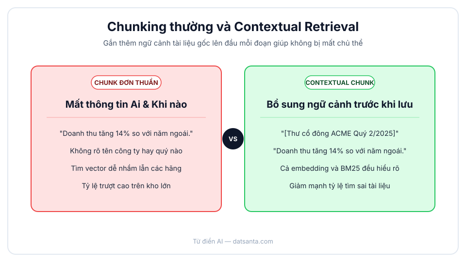

# Contextual Retrieval (Truy xuất kèm ngữ cảnh gốc)

**Contextual retrieval** chèn thêm một đoạn tiêu đề tóm tắt ngắn do LLM sinh ra vào đầu mỗi mảnh tài liệu (chunk) *trước khi* đánh chỉ mục, giúp từng mảnh tách rời không bị mất ngữ cảnh về chủ thể hay nguồn tài liệu gốc.

## Ví dụ thực tế

Nếu một đoạn chunk chỉ ghi `"Doanh thu tăng 14% so với cùng kỳ nhờ tỷ lệ gia hạn doanh nghiệp cao"`, tìm kiếm vector đơn thuần sẽ không biết câu đó nói về *công ty nào* hay *quý mấy*. Contextual retrieval gắn thêm `"Trích từ Thư cổ đông ACME Quý 2/2025, Mục Điểm nhấn tài chính:"` lên đầu đoạn trước khi tạo embedding và BM25—giảm mạnh tỷ lệ tìm trượt trên kho tài liệu lớn.

## Đừng nhầm với

- **[Chunking](chunking.md):** Chunking là bước cắt tài liệu dài thành nhiều mảnh nhỏ; contextual retrieval làm giàu ngữ cảnh cho từng mảnh đó trước khi lưu vào chỉ mục.

## Thuật ngữ liên quan

- [Chunking](chunking.md)
- [Hybrid Search](hybrid-search.md)
- [RAG](rag.md)
