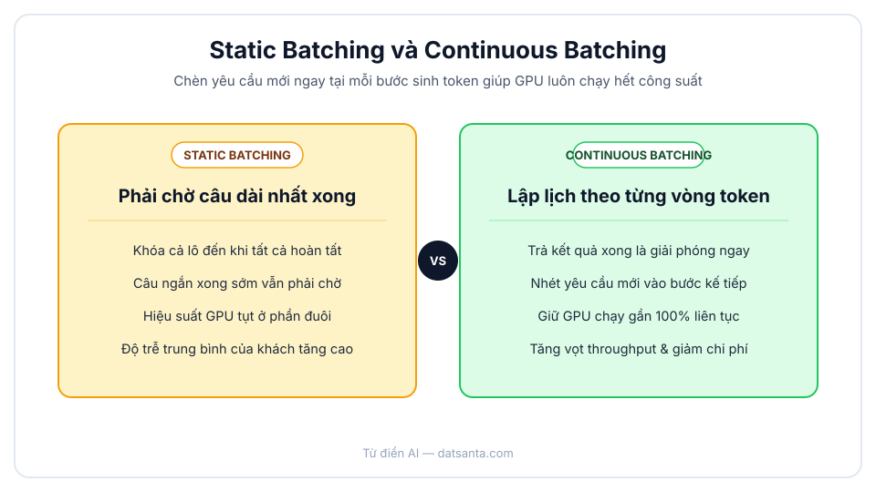

# Continuous Batching (Gom lô liên tục)

**Continuous batching** (lập lịch theo từng vòng lặp) cho phép máy chủ AI chèn ngay yêu cầu mới vào batch GPU đang chạy và giải phóng yêu cầu đã xong tại *mỗi bước sinh token*, thay vì bắt cả nhóm phải chờ câu trả lời dài nhất kết thúc.

## Ví dụ thực tế

Một chuyến xe buýt gom lô tĩnh sẽ khóa cửa không cho ai lên hay xuống cho tới khi hành khách cuối cùng đi hết 100 bến—nếu 9 người xuống từ bến 5 thì 9 ghế đó vẫn bỏ trống suốt 95 bến còn lại. Continuous batching cho phép lên xuống ngay tại mỗi trạm (mỗi token sinh ra), giữ GPU luôn chạy sát 100% công suất và tăng vọt [throughput](latency-vs-throughput.md).

## Đừng nhầm với

- **[Latency vs. Throughput](latency-vs-throughput.md):** Throughput là chỉ số đo tổng số token phục vụ mỗi giây; continuous batching là kỹ thuật lập lịch để đẩy throughput lên tối đa khi nhiều người gọi cùng lúc.

## Thuật ngữ liên quan

- [vLLM](vllm.md)
- [Latency vs. Throughput](latency-vs-throughput.md)
- [Prefill and Decode](prefill-and-decode.md)
