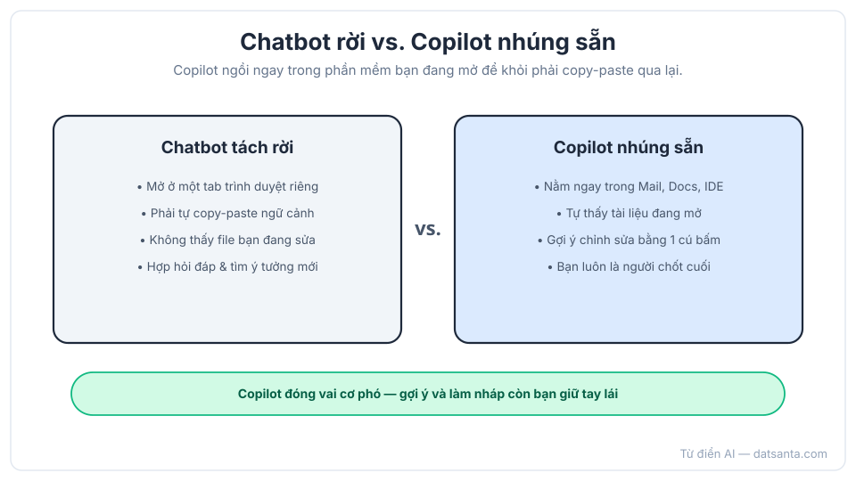

# Copilot (Trợ lý đồng hành)

**Copilot** là trợ lý AI được nhúng thẳng vào phần mềm bạn đang dùng hằng ngày — như trình soạn thảo văn bản, bảng tính, email hay trình viết code — giúp bạn làm nhanh hơn trong khi bạn vẫn giữ quyền quyết định.

## Ví dụ thực tế

Thay vì phải thoát khỏi hộp thư, copy nội dung sang một [chatbot](chatbot.md) riêng rồi dán câu trả lời ngược lại, copilot ngồi ngay trong ứng dụng email của bạn. Nó nhìn thấy sẵn toàn bộ chuỗi thư và gợi ý bản trả lời chỉ với một cú bấm.

Giống như cơ phó trong buồng lái máy bay, copilot gợi ý lộ trình và xử lý các bước kiểm tra lặp lại, còn bạn luôn là người nắm vô lăng.

## Đừng nhầm với

- **Lái tự động / [AI agent](ai-agent.md):** Copilot làm việc *song song* cùng bạn và chờ bạn duyệt; AI agent chạy các chuỗi tác vụ nhiều bước độc lập hơn ở chế độ nền.
- **[Chatbot](chatbot.md):** Chatbot nằm ở một tab trò chuyện tách biệt; copilot nằm ngay trong không gian làm việc và tự thấy tài liệu bạn đang mở.

## Thuật ngữ liên quan

- [Chatbot](chatbot.md)
- [Human-in-the-Loop](human-in-the-loop.md)
- [AI Agent](ai-agent.md)
- [AI Workflow](ai-workflow.md)
