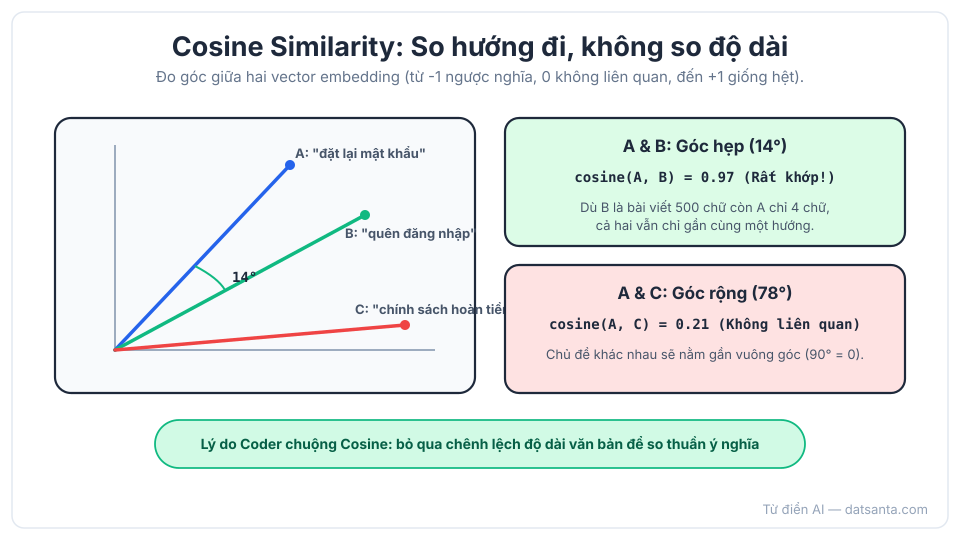

# Cosine Similarity

**Cosine similarity** đo mức độ hai vector [embedding](embeddings.md) chỉ cùng một hướng, trả về điểm từ `-1` (ngược nghĩa), `0` (không liên quan) tới `+1` (giống hệt nhau) mà không bị ảnh hưởng bởi độ dài đoạn văn.

## Ví dụ đời thường

Giả sử một vector đại diện cho câu ngắn `"đặt lại mật khẩu"` và vector kia đại diện cho bài hướng dẫn dài 500 chữ về *"xử lý khi quên đăng nhập"*. Độ dài hai mũi tên chênh nhau nhiều, nhưng cả hai cùng chỉ gần về một hướng (góc `14°`, cosine `0.97`).

Trong khi đó, `"chính sách hoàn tiền"` chĩa sang hướng gần vuông góc (`78°`, cosine `0.21`). Nhờ đo góc thay vì độ dài, cosine similarity so sánh thuần túy độ khớp chủ đề.

## Đừng nhầm với

- **Khoảng cách Euclid (L2):** L2 đo khoảng cách đường thẳng giữa hai đầu mút, dễ bị lệch nếu vector chưa chuẩn hóa độ dài.
- **Đếm từ khóa trùng nhau:** Cosine similarity vẫn khớp tốt kể cả khi hai câu không dùng chung bất kỳ từ nào (như `"xe hơi"` và `"ô tô"`).

## Thuật ngữ liên quan

- [Embeddings](embeddings.md)
- [Vector Database](vector-database.md)
- [Hybrid Search](hybrid-search.md)
