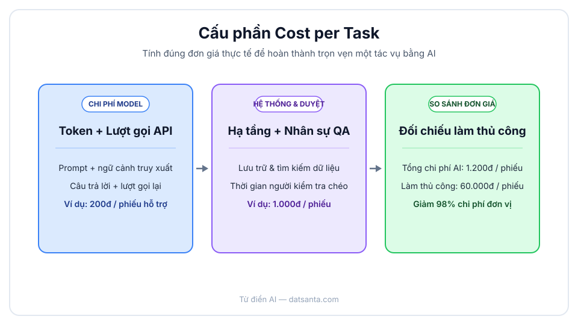

# Cost per Task (Chi phí trên mỗi tác vụ)

**Cost per task** là tổng số tiền thực tế phải trả để hoàn thành một đơn vị công việc bằng AI—chẳng hạn trả lời một phiếu hỗ trợ, tóm tắt một cuộc gọi hoặc viết một mô tả sản phẩm.

## Ví dụ thực tế

Thay vì chỉ hỏi chiếc xe tải tốn bao nhiêu tiền mỗi tháng, bạn tính xem giao xong một đơn hàng tốn hết bao nhiêu tiền xăng, công tài xế và khấu hao xe. Với AI, một model gọn nhẹ có thể tốn 50 đồng để trả lời một câu hỏi đơn giản, trong khi quy trình suy luận phức tạp kèm người kiểm duyệt có thể tốn 4.000 đồng mỗi hồ sơ. Biết rõ cost per task giúp bạn so sánh thẳng với chi phí làm thủ công.

## Đừng nhầm với

- **[TCO (Tổng chi phí sở hữu)](tco.md):** TCO đo tổng chi phí cả hệ thống trong nhiều tháng hoặc nhiều năm; cost per task phóng to vào đơn giá của từng đầu việc hoàn thành.

## Thuật ngữ liên quan

- [Token Budget](token-budget.md)
- [AI ROI](ai-roi.md)
- [Service Tiering](service-tiering.md)
