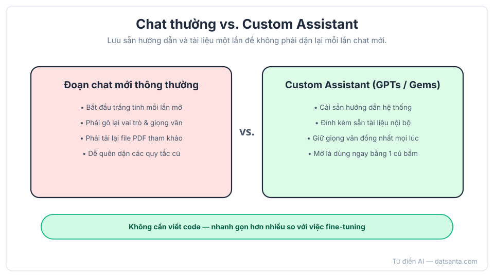

# Custom Assistant (Trợ lý AI tùy chỉnh)

**Custom assistant** (như Custom GPTs, Gemini Gems hay Claude Projects) là phiên bản [chatbot](chatbot.md) được cài sẵn hướng dẫn, giọng văn và tài liệu tham khảo riêng của bạn để bạn không phải dặn đi dặn lại mỗi lần mở chat mới.

## Ví dụ thực tế

Thay vì sáng nào cũng phải gõ *"Hãy đóng vai biên tập viên tiếng Việt, giữ giọng tự nhiên và đối chiếu theo file quy chuẩn đính kèm"*, bạn chỉ cần lưu bộ luật và file PDF đó một lần vào Custom Assistant.

Mỗi lần mở trợ lý đó lên, nó đã nhớ sẵn vai trò, quy tắc và tài liệu của bạn — giống một cộng sự nắm rõ thói quen làm việc ngay từ ngày đầu.

## Đừng nhầm với

- **[Fine-tuning](fine-tuning.md):** Fine-tuning huấn luyện lại [parameters](parameters.md) bên trong mô hình bằng code và GPU; custom assistant chỉ gắn thêm [system prompt](system-prompt.md) và tài liệu quanh mô hình có sẵn trong vài phút.
- **Đoạn chat thông thường:** Đoạn chat thường sẽ quên sạch thiết lập của bạn ngay khi bạn bấm "New Chat" hoặc chạm giới hạn [context window](context-window.md).

## Thuật ngữ liên quan

- [Chatbot](chatbot.md)
- [System Prompt](system-prompt.md)
- [RAG](rag.md)
- [Fine-tuning](fine-tuning.md)
