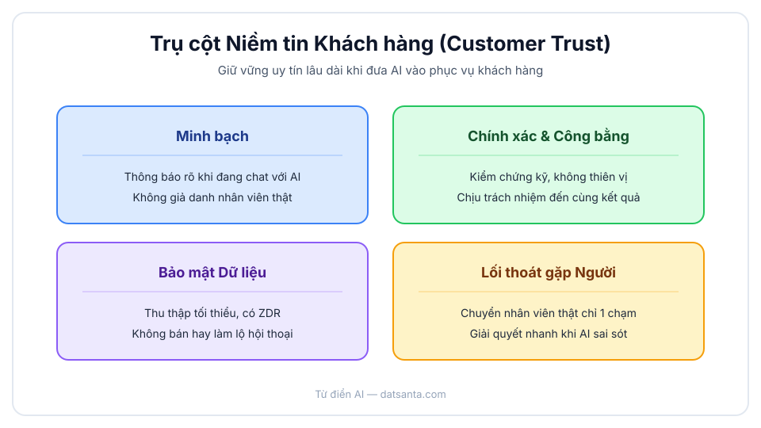

# Customer Trust (Niềm tin khách hàng)

**Customer trust** là sự tin tưởng của khách hàng rằng doanh nghiệp của bạn sử dụng AI trung thực, bảo vệ dữ liệu cá nhân của họ và chịu trách nhiệm đến cùng trước mọi câu trả lời hay quyết định có AI tham gia.

## Ví dụ thực tế

Một khách hàng phát hiện chatbot ẩn danh báo sai chính sách hoàn tiền—mà không có nhân viên nào đứng ra giải quyết—sẽ nhanh chóng mất niềm tin vào cả thương hiệu. Ngược lại, doanh nghiệp gắn nhãn rõ khi dùng AI, cho phép gặp người thật dễ dàng và bảo vệ dữ liệu riêng tư thường tạo được niềm tin cao hơn vì phục vụ vừa nhanh vừa công bằng. Niềm tin xây mất nhiều năm nhưng chỉ một sự cố AI cẩu thả cũng đủ làm sứt mẻ.

## Đừng nhầm với

- **[AI Disclosure](ai-disclosure.md):** Disclosure là hành động thông báo cụ thể cho người dùng biết đang tương tác với AI; customer trust là uy tín dài lâu được xây dựng từ sự minh bạch, chính xác và có trách nhiệm.

## Thuật ngữ liên quan

- [AI Disclosure](ai-disclosure.md)
- [Escalation Path](escalation-path.md)
- [PII](pii.md)
