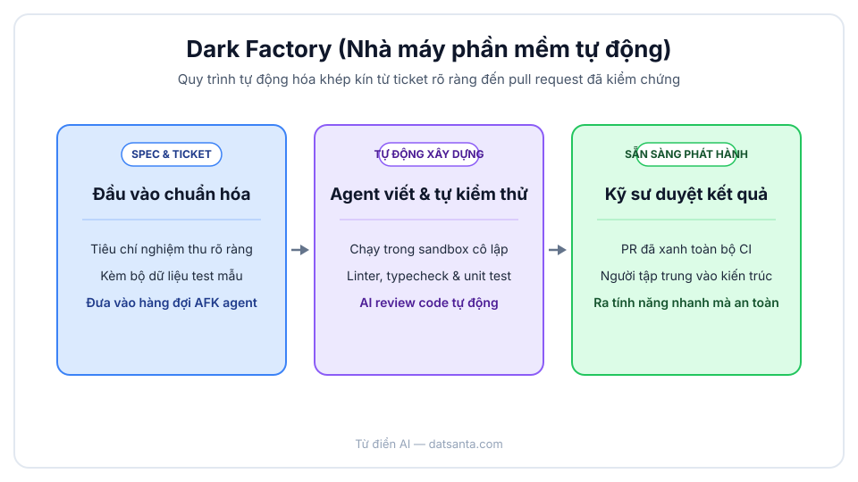

# Dark Factory (Nhà máy phần mềm tự động)

**Dark factory** (hay *software factory*) là mô hình sản xuất phần mềm tự động hóa ở mức cao, nơi các AI agent tự nhận ticket rõ ràng, viết code, chạy test, review pull request và chuẩn bị bản phát hành gần như không cần người gõ code tay.

## Ví dụ thực tế

Thuật ngữ này bắt nguồn từ các nhà máy "tắt đèn" nơi cánh tay robot lắp ráp linh kiện ô tô mà không cần bật đèn cho công nhân. Trong phát triển phần mềm, dark factory kết hợp [spec](spec.md) chặt chẽ, [AFK agent](afk-agent.md), [sandbox](sandbox.md) cô lập và hệ thống kiểm thử tự động—giúp kỹ sư dành thời gian thiết kế kiến trúc và duyệt kết quả thay vì ngồi gõ code lặp lại.

## Đừng nhầm với

- **[Vibe Coding](vibe-coding.md):** Vibe coding là cách prompt ngẫu hứng của một cá nhân để làm bản mẫu nhanh; dark factory dựa vào spec chặt chẽ, cổng CI và kiểm chứng tự động để xuất xưởng code production an toàn.

## Thuật ngữ liên quan

- [AFK Agent](afk-agent.md)
- [Automated Code Review](automated-review.md)
- [Spec](spec.md)
