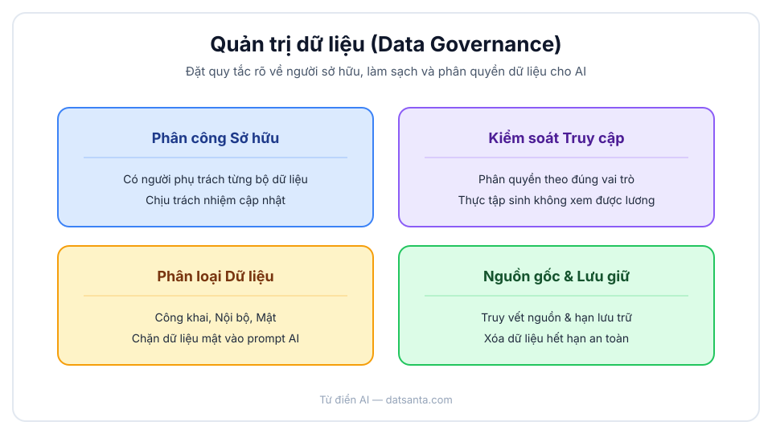

# Data Governance (Quản trị dữ liệu)

**Data governance** là bộ quy tắc, phân công người chịu trách nhiệm và cơ chế phân quyền trong doanh nghiệp nhằm kiểm soát ai được xem, sửa, làm sạch và đưa dữ liệu nào vào hệ thống AI.

## Ví dụ thực tế

Kho lưu trữ của công ty không bao giờ để bảng lương ban giám đốc, hợp đồng khách hàng và tờ rơi quảng cáo chung trên một chiếc bàn cho ai muốn photo cũng được. Luôn có người quản kho, nhãn phân loại và danh sách người giữ chìa khóa từng tủ. Data governance làm đúng vai trò đó trên môi trường số trước khi nối AI vào, giúp chatbot hỗ trợ thực tập sinh không bao giờ vô tình đọc được dữ liệu lương thưởng.

## Đừng nhầm với

- **[Compliance](compliance.md):** Compliance là tuân thủ luật pháp và quy định bên ngoài; data governance là hệ thống quản lý, phân quyền và bảo vệ dữ liệu nội bộ do công ty tự thiết lập.

## Thuật ngữ liên quan

- [Data Quality](data-quality.md)
- [PII](pii.md)
- [Audit Trail](audit-trail.md)
