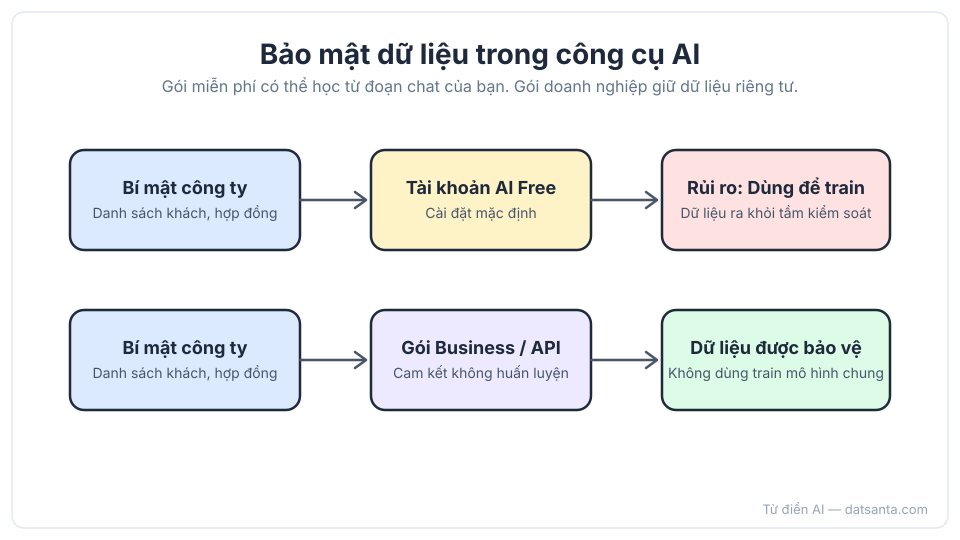

# Data Privacy (Bảo mật dữ liệu AI)

**Data privacy trong AI** là việc kiểm soát xem dữ liệu mật của công ty sẽ đi đâu khi nhân viên gõ hoặc tải lên công cụ AI — và nhà cung cấp AI có quyền lưu trữ hay dùng dữ liệu đó để huấn luyện mô hình chung hay không.

## Ví dụ thực tế

Viết bảng lương khách hàng lên tấm bảng trắng ở quán cà phê công cộng rất khác với việc khóa nó trong két sắt văn phòng.

Các tài khoản AI miễn phí cho người dùng cá nhân thường mặc định lưu lịch sử chat để cải thiện mô hình. Ngược lại, các gói doanh nghiệp (Business/Enterprise) hoặc API trả phí có cam kết hợp đồng không dùng dữ liệu của bạn để huấn luyện cho người khác.

## Đừng nhầm với

- **Mật khẩu đăng nhập:** Mật khẩu mạnh chỉ bảo vệ tài khoản của bạn, không quyết định việc nhà cung cấp AI có giữ lại hoặc học từ nội dung bạn đã dán vào khung chat hay không.
- **[AI governance](ai-governance.md):** Bảo mật dữ liệu là một yêu cầu cốt lõi; còn governance là bộ quy tắc tổng thể về công cụ được phép dùng và trách nhiệm trong toàn công ty.

## Thuật ngữ liên quan

- [Shadow AI](shadow-ai.md)
- [AI Governance](ai-governance.md)
- [RAG](rag.md)
