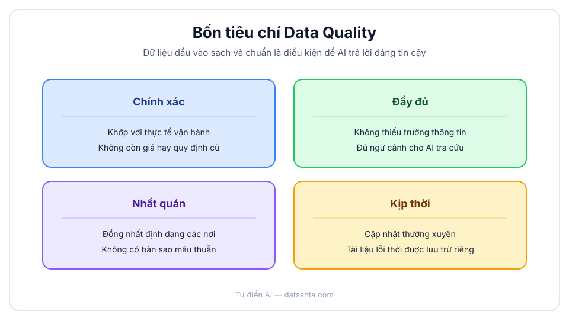

# Data Quality (Chất lượng dữ liệu)

**Data quality** phản ánh mức độ chính xác, đầy đủ, cập nhật và nhất quán của dữ liệu doanh nghiệp—yếu tố quyết định AI sẽ trả lời đáng tin cậy hay tự tin lặp lại những sai sót cũ.

## Ví dụ thực tế

Nếu bảng tồn kho ghi còn 500 chiếc áo khoác mùa đông, nhưng thực tế đã bán 200 chiếc từ tháng trước mà chưa trừ sổ, thì hệ thống AI thông minh nhất cũng sẽ báo nhầm với khách là hàng vẫn còn đủ giao ngay. Nguyên tắc "rác vào thì rác ra" rất đúng với AI: tài liệu trùng lặp, lỗi thời hoặc nhập sai khiến AI trông như bị lỗi dù nguyên nhân nằm ở dữ liệu gốc.

## Đừng nhầm với

- **[Data Silo](data-silo.md):** Data silo là dữ liệu bị cô lập ở nhiều hệ thống rời rạc; data quality đo xem bản thân thông tin bên trong có sạch và đúng sự thật hay không.

## Thuật ngữ liên quan

- [Data Governance](data-governance.md)
- [AI Readiness](ai-readiness.md)
- [RAG](rag.md)
