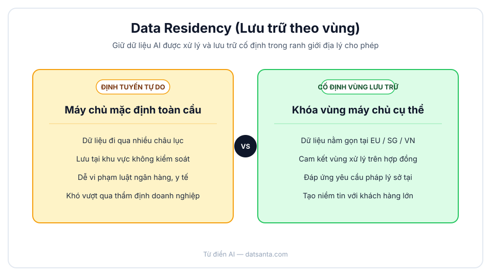

# Data Residency (Lưu trữ dữ liệu theo vùng)

**Data residency** là yêu cầu pháp lý hoặc quy định nội bộ buộc dữ liệu doanh nghiệp và khách hàng khi xử lý bằng AI phải được lưu trữ cố định trong một quốc gia hoặc khu vực địa lý cụ thể.

## Ví dụ thực tế

Một ngân hàng châu Âu hoặc một bệnh viện tại Việt Nam thường không thể gửi hồ sơ bệnh án hay dữ liệu tài chính sang máy chủ đặt ở châu lục khác chỉ vì công cụ AI đặt server ở đó. Giống như việc cất giữ sổ sách thuế trong két sắt tại chi nhánh trong nước, data residency yêu cầu chọn đúng vùng máy chủ—như Singapore, Tokyo hay Frankfurt—để dữ liệu không vượt biên giới trái quy định.

## Đừng nhầm với

- **[Zero Data Retention](zero-data-retention.md):** Data residency kiểm soát *nơi* đặt máy chủ vật lý; zero data retention kiểm soát việc nhà cung cấp AI *có giữ lại* dữ liệu của bạn sau khi trả lời hay không.

## Thuật ngữ liên quan

- [Compliance](compliance.md)
- [Enterprise Agreement](enterprise-agreement.md)
- [EU AI Act](eu-ai-act.md)
