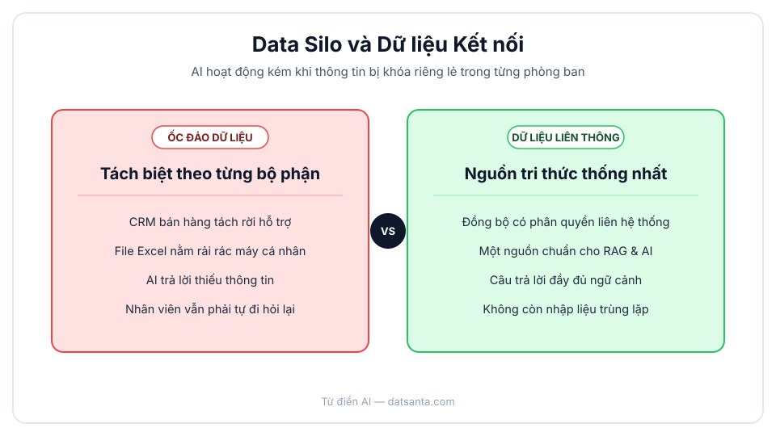

# Data Silo (Ốc đảo dữ liệu)

**Data silo** là tình trạng dữ liệu bị kẹt riêng lẻ trong từng phòng ban hoặc phần mềm tách biệt, khiến các bộ phận khác và hệ thống AI không thể truy cập hay kết nối để dùng chung.

## Ví dụ thực tế

Hãy hình dung một bệnh viện nơi quầy lễ tân lưu số điện thoại bệnh nhân trong file Excel, phòng xét nghiệm lưu kết quả trên máy tính nội bộ, còn nhà thuốc dùng phần mềm riêng không kết nối với ai. Dù bạn thuê trợ lý giỏi đến đâu, họ vẫn không thể trả lời nhanh cho bệnh nhân nếu không chạy đi hỏi từng phòng. AI cũng bất lực y hệt khi dữ liệu công ty nằm rải rác trong các ốc đảo tách rời.

## Đừng nhầm với

- **[Data Quality](data-quality.md):** Data quality nói về việc dữ liệu có chính xác và sạch sẽ hay không; data silo là việc dữ liệu dù tốt nhưng bị khóa kín ở từng nơi, không chia sẻ được.

## Thuật ngữ liên quan

- [Data Governance](data-governance.md)
- [AI Readiness](ai-readiness.md)
- [RAG](rag.md)
