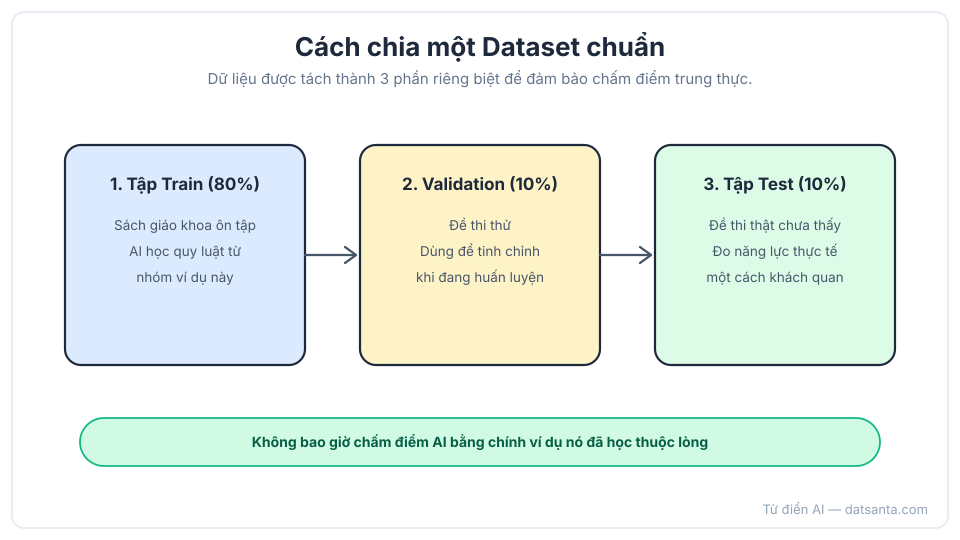

# Dataset (Tập dữ liệu)

**Dataset** là một tập hợp các ví dụ được sắp xếp gọn gàng — như bảng tính, bộ ảnh đã gắn nhãn hay cặp câu hỏi–đáp án — dùng để huấn luyện, kiểm tra hoặc đánh giá một hệ thống AI.

## Ví dụ thực tế

Hãy nghĩ tới việc ôn thi bằng lái xe. Bạn học từ sách câu hỏi ôn tập (**tập train**), tự kiểm tra bằng vài đề thi thử (**tập validation**), rồi bước vào đề thi thật hoàn toàn mới chưa từng gặp (**tập test**).

Các đội làm AI cũng chia dataset theo đúng 3 phần đó. Nếu lỡ lấy đúng câu AI đã học thuộc lòng ra chấm điểm, mô hình sẽ có điểm ảo rất cao nhưng ra đời thực lại làm sai.

## Đừng nhầm với

- **Thư mục file thô:** Một thư mục chứa đầy file PDF lộn xộn chỉ là tài liệu thô; dataset là dữ liệu đã được làm sạch, chuẩn hóa cấu trúc để AI hoặc bộ [evals](evals.md) đọc được.
- **[Training data](training-data.md):** Training data chỉ là phần dùng để học; một dataset chuẩn luôn chừa lại phần riêng chưa từng thấy để kiểm tra trung thực.

## Thuật ngữ liên quan

- [Training Data](training-data.md)
- [Evals](evals.md)
- [Benchmark](benchmark.md)
- [Machine Learning](machine-learning.md)
