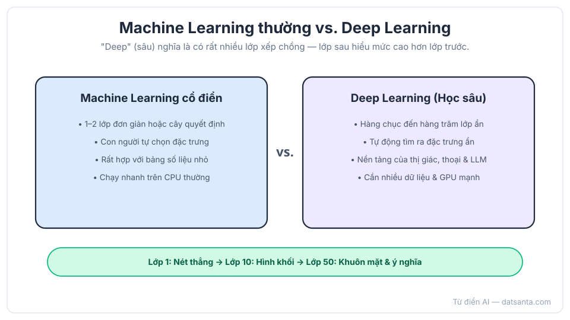

# Deep Learning (Học sâu)

**Deep learning** là một nhánh của [machine learning](machine-learning.md) sử dụng [neural network](neural-network.md) có rất nhiều lớp xếp chồng để học các quy luật phức tạp — như nhận diện khuôn mặt, dịch giọng nói hay viết văn bản.

## Ví dụ thực tế

Hãy nghĩ về cách bạn học đọc. Đầu tiên bạn nhận ra nét thẳng và nét cong, tiếp theo là chữ cái, rồi ghép thành từ, rồi hiểu cả câu văn và giọng mỉa mai. Mỗi tầng hiểu biết đều đứng trên tầng trước đó.

Chữ **"deep" (sâu)** chỉ đơn giản là có hàng chục đến hàng trăm lớp như vậy xếp chồng lên nhau. Lớp đầu nhận ra chi tiết nhỏ (điểm ảnh, ký tự), còn lớp sâu hơn hiểu ý nghĩa tổng thể (giống chó hay ý chính câu chuyện).

## Đừng nhầm với

- **[Machine learning](machine-learning.md):** Machine learning bao gồm cả các thuật toán đơn giản hơn (như cây quyết định trên bảng Excel); deep learning chuyên dùng mạng nơ-ron nhiều lớp và cần lượng dữ liệu cùng GPU lớn hơn nhiều.
- **Tư duy sâu sắc:** "Sâu" chỉ số lượng lớp trong mạng, không mang nghĩa AI có chiều sâu triết lý.

## Thuật ngữ liên quan

- [Neural Network](neural-network.md)
- [Machine Learning](machine-learning.md)
- [Transformer](transformer.md)
- [Training Data](training-data.md)
