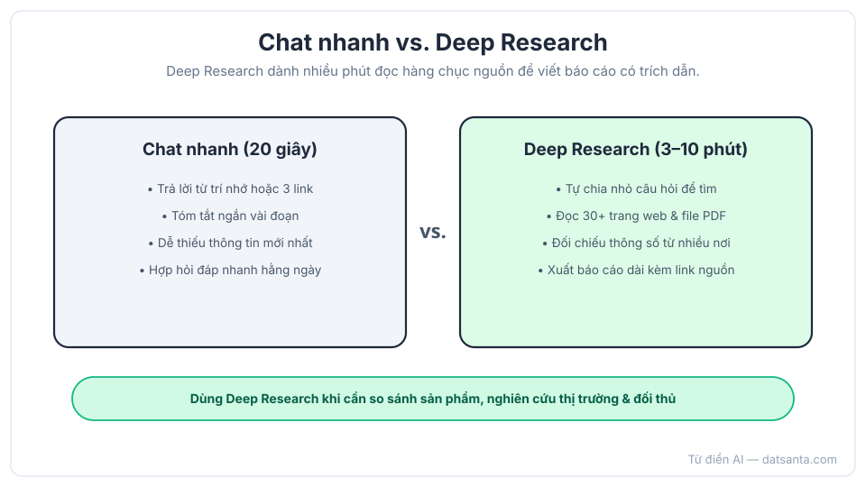

# Deep Research (Nghiên cứu sâu)

**Deep research** là tính năng AI dành vài phút tự động duyệt hàng chục trang web, đọc tài liệu PDF, đối chiếu nhiều nguồn và viết thành báo cáo có cấu trúc kèm trích dẫn — thay vì chỉ trả lời nhanh một đoạn ngắn.

## Ví dụ thực tế

Khi bạn hỏi [chatbot](chatbot.md) thường *"So sánh các mẫu xe máy điện tốt nhất dưới 30 triệu năm 2026"*, nó trả lời sau 20 giây dựa trên trí nhớ cũ nên dễ thiếu mẫu mới hoặc sai giá.

Với Deep Research, AI làm việc như một trợ lý phân tích: tự chia nhỏ câu hỏi, tìm hơn 30 trang web, đọc bảng thông số, tổng hợp đánh giá và xuất ra bản báo cáo nhiều trang kèm link nguồn để bạn tự kiểm chứng.

## Đừng nhầm với

- **Tìm kiếm web nhanh:** Tìm kiếm thường chỉ lướt 3–5 link để đáp nhanh; deep research chạy vòng lặp [AI agent](ai-agent.md) nhiều bước để đọc sâu và tổng hợp bài bản.
- **Độ chính xác tuyệt đối 100%:** Kể cả báo cáo có gắn link nguồn vẫn có thể hiểu nhầm một chi tiết trên trang web, nên bạn vẫn cần bấm kiểm tra lại các nguồn quan trọng.

## Thuật ngữ liên quan

- [AI Agent](ai-agent.md)
- [RAG](rag.md)
- [Hallucination](hallucination.md)
- [Chatbot](chatbot.md)
