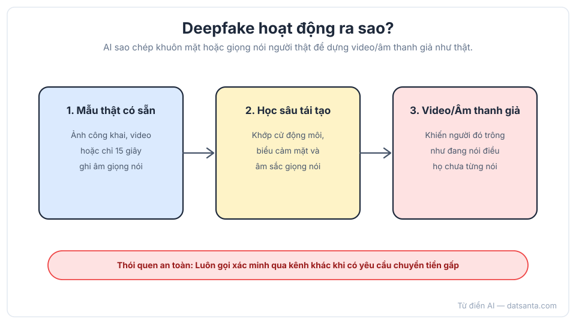

# Deepfake

**Deepfake** là video, hình ảnh hoặc đoạn ghi âm được tạo hay chỉnh sửa bằng AI để làm cho một người thật trông như đang nói hoặc làm điều họ chưa từng thực hiện.

## Ví dụ thực tế

Hãy tưởng tượng bạn nhận một cuộc gọi khẩn cấp nghe giống hệt giọng người thân nhờ chuyển khoản gấp — hoặc thấy một đoạn clip như thật quay cảnh một CEO quảng bá dự án tiền ảo giả mạo.

Từ này ghép từ **[deep learning](deep-learning.md)** và **fake (giả)**. Dù cùng công nghệ có thể dùng để lồng tiếng phim rất tự nhiên, kẻ xấu cũng lợi dụng nó để lừa đảo, nên thói quen kiểm chứng nguồn tin là cực kỳ quan trọng.

## Đừng nhầm với

- **Bộ lọc ảnh thông thường:** Filter cơ bản chỉ làm mịn da hay gắn kính dễ nhận ra; deepfake tái tạo khớp cả cử động môi, biểu cảm khuôn mặt và âm sắc giọng nói tự động.
- **[AI watermark](ai-watermark.md):** Watermark là dấu nhận diện phòng vệ nhằm giúp mọi người phát hiện nội dung do AI tạo ra như deepfake.

## Thuật ngữ liên quan

- [Deep Learning](deep-learning.md)
- [Text-to-Speech](text-to-speech.md)
- [AI Watermark](ai-watermark.md)
- [AI Literacy](ai-literacy.md)
