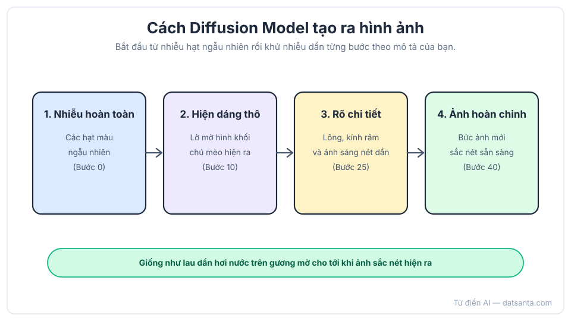

# Diffusion Model (Mô hình khuếch tán)

**Diffusion model** là kỹ thuật AI đứng sau phần lớn công cụ tạo ảnh và video hiện đại. Nó tạo tranh bằng cách bắt đầu từ màn hình nhiễu hạt ngẫu nhiên rồi khử nhiễu từng bước một cho đến khi hình ảnh rõ nét hiện ra.

## Ví dụ thực tế

Hãy nghĩ tới người thợ điêu khắc đẽo từng nhát vào khối đá — hoặc việc lau dần hơi nước trên gương phòng tắm cho đến khi gương mặt sắc nét hiện ra.

Lúc huấn luyện, AI tập thêm nhiễu hạt vào hàng triệu bức ảnh cho tới khi mờ tịt rồi học cách làm ngược lại. Khi bạn gõ *"một chú mèo đeo kính râm"*, nó bắt đầu từ nhiễu ngẫu nhiên và gọt giũa dần qua 20–50 bước nhỏ để tạo ra đúng bức tranh đó.

## Đừng nhầm với

- **[LLM](llm.md):** LLM sinh chữ từng [token](token.md) một từ trái sang phải; diffusion model tinh chỉnh toàn bộ bức ảnh cùng lúc qua nhiều vòng khử nhiễu liên tiếp.
- **Tìm ảnh hay cắt ghép:** Diffusion model không cắt dán ảnh có sẵn trên mạng; nó tự tổng hợp từng điểm ảnh mới dựa trên quy luật hình ảnh đã học.

## Thuật ngữ liên quan

- [Text-to-Image](text-to-image.md)
- [Generative AI](generative-ai.md)
- [AI Watermark](ai-watermark.md)
- [Prompt](prompt.md)
