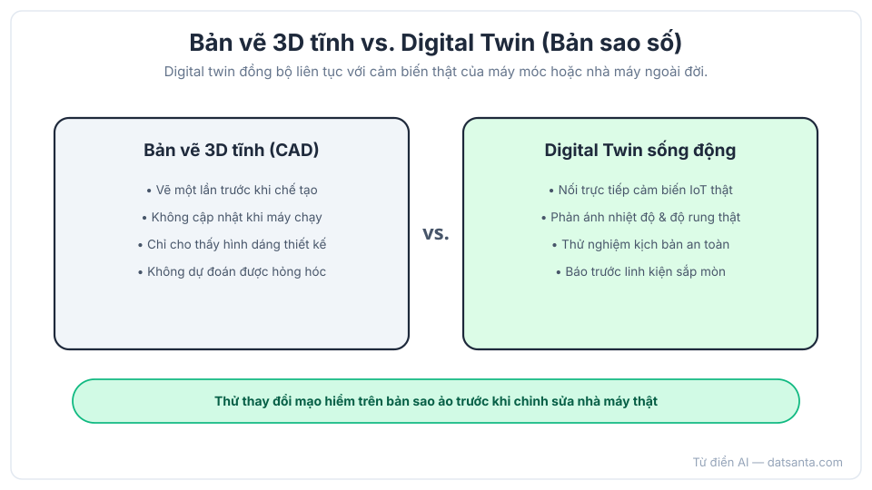

# Digital Twin (Bản sao số)

**Digital twin** là một bản sao ảo sống động của vật thể, máy móc, nhà máy hoặc thành phố ngoài đời thực, liên tục cập nhật dữ liệu từ cảm biến thật để đội ngũ thử nghiệm thay đổi an toàn trước khi đụng vào tài sản vật lý.

## Ví dụ thực tế

Hãy nghĩ tới mô hình 3D trực tiếp giống game của một tuabin gió hoặc kho hàng thật. Cảm biến gắn trên tuabin ngoài đời truyền liên tục nhiệt độ, tốc độ gió và độ rung thẳng vào bản sao số của nó.

Kỹ sư và AI có thể thử nghiệm *"Điều gì xảy ra nếu tăng tốc dây chuyền 3 thêm 15%?"* hoặc dự đoán linh kiện sắp mòn ngay trên bản sao ảo — tránh được những lần dừng máy đắt đỏ ngoài nhà máy thật.

## Đừng nhầm với

- **Bản vẽ CAD 3D tĩnh:** Bản vẽ thiết kế chỉ cho thấy hình dáng sản phẩm ở ngày đầu; digital twin luôn nối sống với luồng dữ liệu cảm biến thực tế theo thời gian.
- **Mô phỏng một lần:** Mô phỏng thông thường chạy theo giả định lý thuyết; digital twin phản ánh *trạng thái hiện tại thực sự* của đúng một thiết bị cụ thể ngoài đời.

## Thuật ngữ liên quan

- [Synthetic Data](synthetic-data.md)
- [Automation](automation.md)
- [AI](ai.md)
