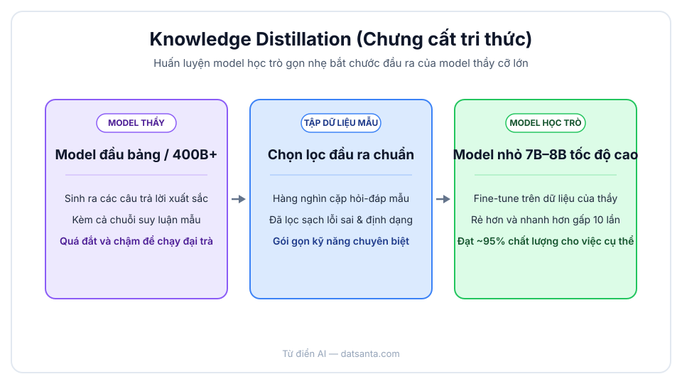

# Knowledge Distillation (Chưng cất tri thức)

**Knowledge distillation** là quá trình huấn luyện một model "học trò" nhỏ gọn, tốc độ cao để bắt chước đầu ra và cách suy luận của một model "thầy" khổng lồ, đắt đỏ hơn nhiều.

## Ví dụ thực tế

Một bếp trưởng bánh ngọt mất 20 năm tự thử nghiệm mới tìm ra công thức chuẩn, rồi viết lại bí quyết từng bước để người học việc làm được tới 95% chất lượng chỉ sau vài tuần. Trong AI, lập trình viên tạo hàng nghìn ví dụ mẫu chất lượng cao từ model đầu bảng rồi fine-tune lại một model mở 8B trên bộ dữ liệu đó—giảm độ trễ và chi phí API gấp 10 lần cho các tác vụ chuyên biệt.

## Đừng nhầm với

- **[Quantization](quantization.md):** Quantization nén *cùng một model đó* bằng cách dùng ít bit hơn cho mỗi trọng số; distillation huấn luyện một *kiến trúc model nhỏ hoàn toàn khác*.

## Thuật ngữ liên quan

- [LoRA](lora.md)
- [Quantization](quantization.md)
- [Fine-tuning](fine-tuning.md)
