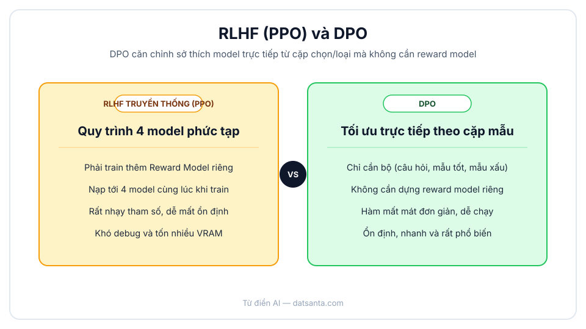

# DPO (Tối ưu hóa Ưu tiên Trực tiếp)

**DPO (Direct Preference Optimization)** là phương pháp hậu huấn luyện giúp model ưu tiên câu trả lời hữu ích và an toàn dựa trực tiếp trên các cặp ví dụ "nên chọn / nên loại"—mà không cần huấn luyện thêm một reward model riêng.

## Ví dụ thực tế

Trong [RLHF](rlhf.md) truyền thống, bạn phải huấn luyện riêng một model "giám khảo ẩm thực" rồi mới dùng học tăng cường để chiều lòng giám khảo đó—rất phức tạp và dễ mất ổn định. Với DPO, bạn đưa thẳng từng cặp món ăn đặt cạnh nhau ("khách rất thích Đĩa A, chê Đĩa B") và điều chỉnh công thức trực tiếp để tăng xác suất làm ra Đĩa A. Code huấn luyện đơn giản hơn nhiều mà hiệu quả căn chỉnh tương đương.

## Đừng nhầm với

- **[RLHF](rlhf.md):** RLHF cần huấn luyện một reward model riêng cùng thuật toán PPO; DPO bỏ qua reward model và tối ưu trực tiếp trên dữ liệu ưu tiên.

## Thuật ngữ liên quan

- [RLHF](rlhf.md)
- [Fine-tuning](fine-tuning.md)
- [LoRA](lora.md)
