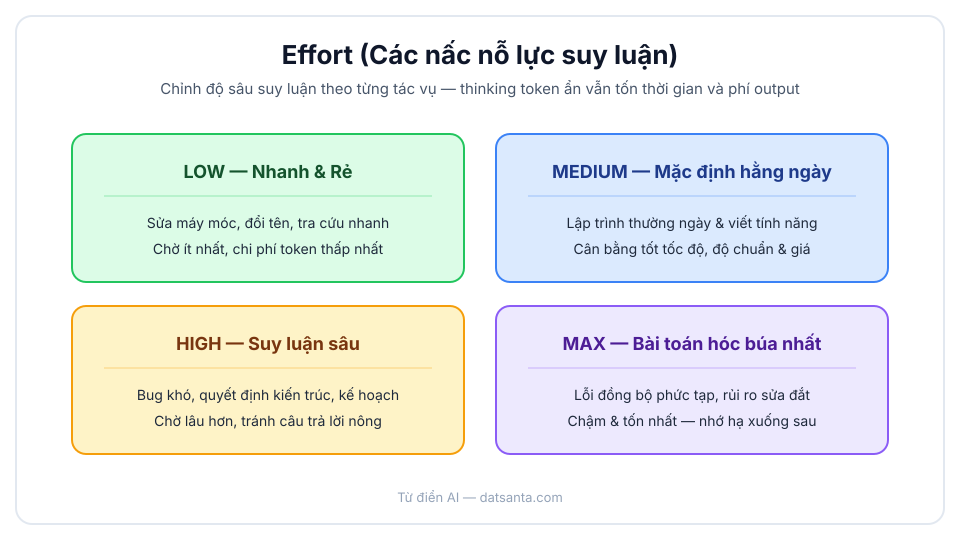

# Effort (Mức độ nỗ lực suy luận)

**Effort** là tham số tùy chỉnh theo từng lượt gọi API để quyết định một [mô hình suy luận](reasoning-model.md) được phép suy nghĩ nội bộ lâu đến đâu trước khi viết câu trả lời cuối—đánh đổi thêm thời gian chờ và chi phí token để lấy độ sâu suy luận.

## Ví dụ thực tế

Hãy hình dung bạn hỏi một kỹ sư kỳ cựu: với việc `"đổi tên biến này"`, họ trả lời ngay trong một giây; nhưng với `"tìm lỗi xung đột luồng hiếm gặp"`, họ cần mười phút im lặng lần theo log trước khi kết luận. Mô hình suy luận cũng có các nấc `Low`, `Medium`, `High`, `Max`. Dù giao diện thường ẩn quá trình suy nghĩ đó đi, từng *thinking token* vẫn được sinh ra thật ở pha suy luận và **tính phí như output token**. Để mức quá thấp cho bài khó sẽ nhận câu trả lời nghe tự tin nhưng hời hợt; để `Max` cho việc sửa một dòng code lại khiến bạn chờ lâu và tốn tiền vô ích. Hãy chỉnh effort theo từng tác vụ, không cố định cho cả phiên.

## Đừng nhầm với

- **[Temperature](temperature.md):** Temperature chỉnh độ ngẫu nhiên và sáng tạo khi chọn từ tiếp theo; effort chỉnh lượng token mà model dành để suy luận trước khi trả lời.
- **[Chain of Thought (CoT)](chain-of-thought.md):** CoT là kỹ thuật nhắc trong prompt bảo model viết từng bước; effort là tham số tích hợp sẵn để điều chỉnh ngân sách suy nghĩ nội bộ của model.

## Thuật ngữ liên quan

- [Reasoning Model](reasoning-model.md)
- [TTFT (Time to First Token)](ttft.md)
- [Token Budget](token-budget.md)
