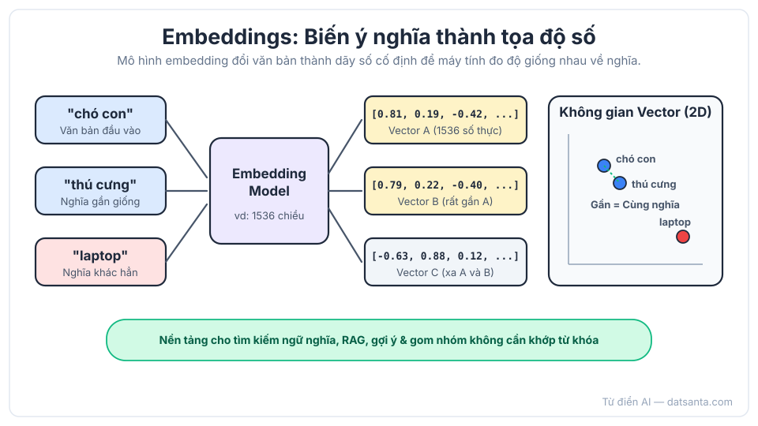

# Embeddings

**Embeddings** chuyển đổi văn bản, code hoặc hình ảnh thành một dãy số cố định (vector) để biểu diễn ý nghĩa. Những đoạn có nghĩa gần giống nhau sẽ tạo ra các vector nằm sát nhau trong không gian toán học.

## Ví dụ thực tế

Hãy nghĩ tới tọa độ GPS cho ý tưởng. Một quán cà phê và một tiệm bánh nằm sát tọa độ nhau trên bản đồ, còn tiệm rửa xe nằm cách xa hàng cây số — dù hai chữ *"cà phê"* và *"tiệm bánh"* chẳng giống nhau về mặt chữ cái.

Trong code, bạn đưa `"chó con"` và `"thú cưng"` qua một model embedding và nhận về 2 mảng 1536 con số có điểm [cosine similarity](cosine-similarity.md) rất cao. Nhờ đó thanh tìm kiếm hiểu được ý định người dùng thay vì chỉ khớp cứng từng từ khóa.

## Đừng nhầm với

- **[Token](token.md) ID:** Token ID chỉ là số thứ tự trong từ điển (`"chó"` = `9703`), không mang nghĩa; embeddings mã hóa sâu mối quan hệ ngữ nghĩa qua nhiều chiều.
- **[Vector database](vector-database.md):** Embeddings là bản thân các mảng số; vector database là kho lưu trữ chuyên đánh chỉ mục và tìm nhanh trên hàng triệu mảng số đó.

## Thuật ngữ liên quan

- [Cosine Similarity](cosine-similarity.md)
- [Vector Database](vector-database.md)
- [RAG](rag.md)
- [Chunking](chunking.md)
