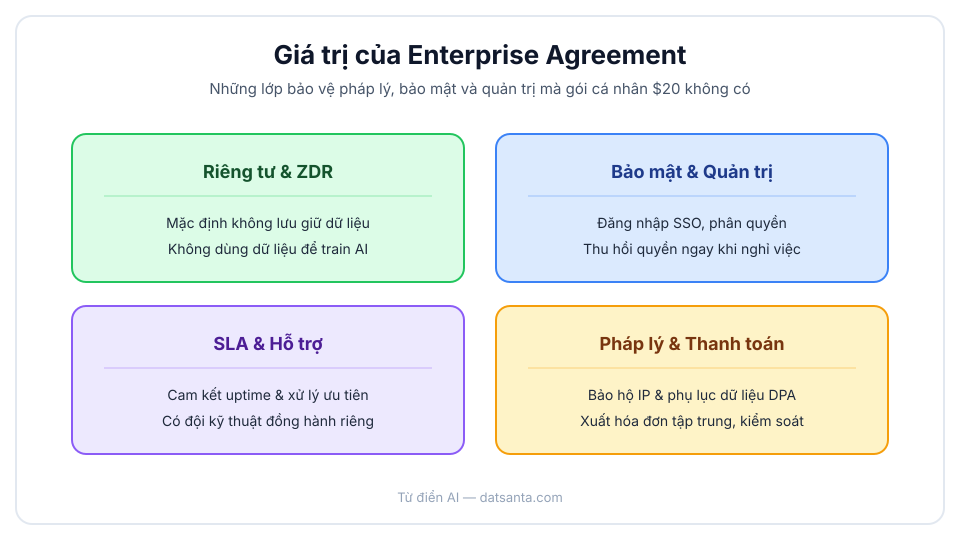

# Enterprise Agreement (Hợp đồng Doanh nghiệp)

**Enterprise agreement** là hợp đồng thương mại chính thức ký với nhà cung cấp AI, bổ sung các cam kết pháp lý, bảo vệ quyền riêng tư, thanh toán tập trung, phân quyền quản trị và cam kết ổn định (SLA) mà gói cá nhân không có.

## Ví dụ thực tế

Mua tài khoản cá nhân 20 USD bằng thẻ tín dụng riêng không mang lại cho công ty tính năng đăng nhập một lần (SSO), bảo hộ pháp lý hay cam kết không lấy dữ liệu đi huấn luyện. Enterprise agreement là hợp đồng chuẩn doanh nghiệp: nó khóa chặt điều khoản zero data retention, lưu trữ theo vùng, giá theo sản lượng, SLA vận hành và quyền thu hồi tài khoản ngay khi nhân viên nghỉ việc.

## Đừng nhầm với

- **[SLA](sla.md):** SLA là cam kết kỹ thuật về thời gian hoạt động và tốc độ phản hồi; enterprise agreement là hợp đồng tổng thể bao gồm SLA cùng điều khoản bảo mật, thanh toán và trách nhiệm pháp lý.

## Thuật ngữ liên quan

- [Zero Data Retention](zero-data-retention.md)
- [Vendor Lock-in](vendor-lock-in.md)
- [SLA](sla.md)
