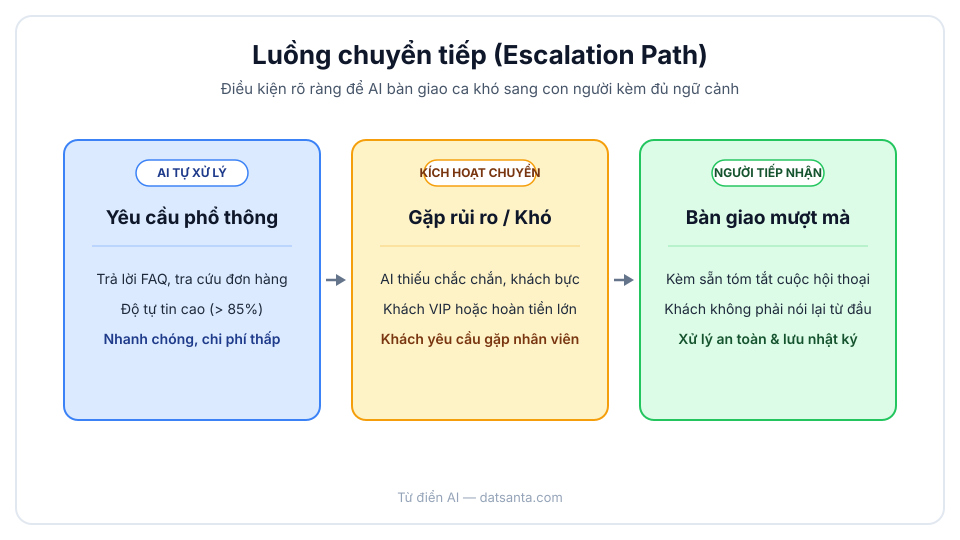

# Escalation Path (Luồng chuyển tiếp xử lý)

**Escalation path** là quy tắc rõ ràng xác định khi nào hệ thống AI phải dừng tự xử lý để chuyển ca làm việc sang cho con người—kèm theo người nhận cụ thể và toàn bộ ngữ cảnh đã trao đổi.

## Ví dụ thực tế

Tổng đài tự động của phòng khám có thể đặt lịch khám định kỳ, nhưng ngay khi bệnh nhân nhắc đến "đau ngực" hoặc bấm phím gặp y tá hai lần, hệ thống lập tức nối máy sang nhân viên trực cùng tên tuổi và triệu chứng vừa ghi nhận. Trong chăm sóc khách hàng hay tài chính, escalation path giúp chặn kịp thời các ca AI thiếu tự tin, khách hàng bức xúc hoặc giao dịch giá trị lớn.

## Đừng nhầm với

- **[Human-in-the-Loop](human-in-the-loop.md):** Human-in-the-loop là nguyên lý thiết kế chung có con người tham gia giám sát AI; escalation path là điều kiện kích hoạt và tuyến chuyển giao cụ thể khi AI gặp ca khó.

## Thuật ngữ liên quan

- [SLA](sla.md)
- [Service Tiering](service-tiering.md)
- [Guardrails](guardrails.md)
