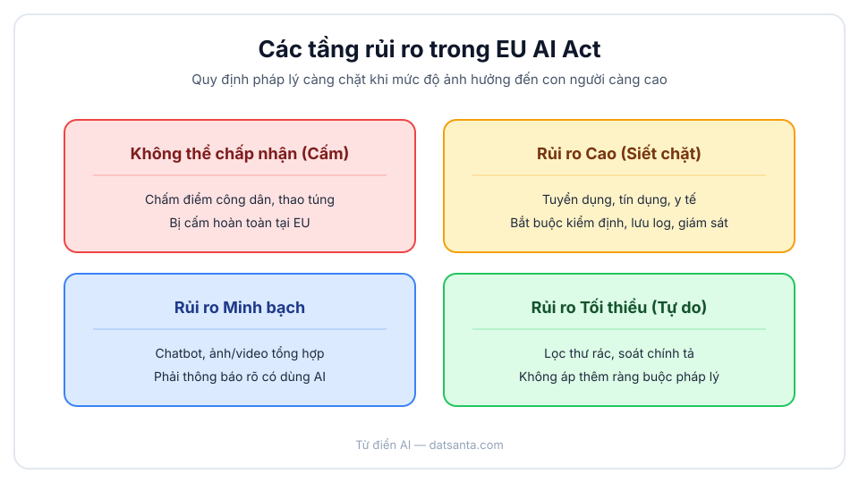

# EU AI Act (Đạo luật AI châu Âu)

**EU AI Act** là bộ luật tiên phong của Liên minh châu Âu quản lý hệ thống AI theo từng mức độ rủi ro đối với an toàn và quyền lợi con người—áp dụng cho mọi doanh nghiệp có khách hàng tại châu Âu.

## Ví dụ thực tế

Luật giao thông không quản lý chuông xe đạp khắt khe như hệ thống phanh máy bay thương mại. EU AI Act chia AI làm 4 tầng rủi ro: cấm hẳn AI chấm điểm công dân hay thao túng hành vi; siết chặt kiểm định với AI rủi ro cao như tuyển dụng hay y tế; bắt buộc gắn nhãn minh bạch với chatbot; và gần như không can thiệp vào công cụ ít rủi ro như bộ lọc thư rác.

## Đừng nhầm với

- **[Compliance](compliance.md):** Compliance là hoạt động tuân thủ mọi quy định nói chung; EU AI Act là một bộ luật cụ thể đang định hình tiêu chuẩn quản lý AI toàn cầu.

## Thuật ngữ liên quan

- [AI Disclosure](ai-disclosure.md)
- [Model Risk Management](model-risk-management.md)
- [Audit Trail](audit-trail.md)
